# PokeAI: Progressive Lesson 0 – Lesson 11 UI & AI Storyboard

> **How to Read This Storyboard**
> Every lesson in **PokeAI** builds directly onto the screen from the previous lesson. You begin in **Lesson 0** with the landing screen loading `.env` game metadata (`GAME_TITLE="PokeAI"`, `VERSION="0.1.0"`, `PROJECT_GOAL`, `GAME_DESCRIPTION`, `GAME_GUIDE`, `BACKEND_CORS_ORIGINS`) from `backend/src/core/config.py`. In **Lesson 1**, your persistent **Game Guide** appears on the **RIGHT side** of the dialogue overlay to ask for your name and starter monster. Across **Lessons 2–11**, the Game Guide stays with you on the right side as your AI Coach and Explainer!

---

## High-Level Screen Evolution Flow

```mermaid
flowchart LR
    L0["L0: Landing (.env Game Info)"] --> L1["L1: Right-Side Game Guide (Name & Starters)"]
    L1 --> L2["L2: Resilient AI Brain & Gateway"]
    L2 --> L3["L3: PokeAPI Async Lore Ingestion"]
    L3 --> L4["L4: ChromaDB Vector Memory & Pokédex"]
    L4 --> L5["L5: Classic GBA Battle Arena"]
    L5 --> L6["L6: 5-Turn Rules, TEAM & +1% Stats"]
    L6 --> L7["L7: Catch Roulette Phase"]
    L7 --> L8["L8: ASK GUIDE RAG Coach"]
    L8 --> L9["L9: Autonomous Gym Leader"]
    L9 --> L10["L10: SSE Live Stadium Announcer"]
    L10 --> L11["L11: Production Evals & Docker"]
```



---

## Screen 0 (Lesson 0): Full-Stack `.env` Onboarding & Right-Side Game Guide (4 Sub-Screens)

### Screen 0.1 — The Landing Screen (Displaying `.env` Metadata from `core/config.py`)
```text
+-----------------------------------------------------------------------------------+
| POKEAI [v0.1.0 | APP_ENV: local]           [🟢 Python 3.12 FastAPI: Connected]   |
+-----------------------------------------------------------------------------------+
|                                                                                   |
|                            ⚡  P O K E A I  ⚡                                  |
|       "A turn-based monster battler engineered step-by-step to master             |
|                        AI Engineering principles."                                |
|                                                                                   |
|   +---------------------------------------------------------------------------+   |
|   | 🎯 PROJECT_GOAL (from backend/.env -> src/core/config.py):                |   |
|   | "AI Engineering Path while building a turn-based monster battler game."   |   |
|   | 👩‍🎓 GAME_GUIDE: Shaneil  |  📦 VERSION: 0.1.0  |  🌐 ENV: local            |   |
|   +---------------------------------------------------------------------------+   |
|                                                                                   |
|                      >>> [ PRESS ANY KEY TO CONTINUE ] <<<                        |
|                                                                                   |
+-----------------------------------------------------------------------------------+
```

### Screen 0.2 — Game Guide JRPG Welcome (Game Guide Overlay on the RIGHT Side)
*(Game Guide portrait and nameplate badge anchored on the **RIGHT** side of the framed bottom dialogue box, with `[Press A to Next ▸]` indicator at the bottom-right)*
```text
+-----------------------------------------------------------------------------------+
| POKEAI [v0.1.0] — ACADEMY HALL             [🟢 FastAPI /api/v1/onboarding/welcome]|
+-----------------------------------------------------------------------------------+
|                                                                      .---.        |
|               [ Academy Hall Background Scene ]                     / 🌸  \       |
|                                                                    | ^   ^ |      |
|                                                                    |  '-'  |      |
|                                                                   /|  💎   |\     |
|                                                                  / |       | \    |
|                                                                    |       |      |
|                                                           +-------------------+   |
|                        (Game Guide & Future AI Coach)     | 💎 G A M E  G U I D E |
| +---------------------------------------------------------+-------------------+--+|
| | "Welcome to PokeAI! I'm your Game Guide and AI Engineering Coach.             ||
| |  Together, we'll master AI Engineering principles step-by-step while           ||
| |  building and battling inside this arena!"                                     ||
| |                                                        [ Press A to Next ▸ ]   ||
| +--------------------------------------------------------------------------------+|
+-----------------------------------------------------------------------------------+
```

### Screen 0.3 — Game Guide Asking the Player to Input His/Her Name (Game Guide on the RIGHT Side)
```text
+-----------------------------------------------------------------------------------+
| POKEAI [v0.1.0] — TRAINER REGISTRATION     [🟢 Guide: Online | Step 3 of 4]       |
+-----------------------------------------------------------------------------------+
|                                                                                   |
|             +-------------------------------------------------------+             |
|             |              🪪  TRAINER REGISTRATION CARD            |             |
|             |-------------------------------------------------------|             |
|             |  Please enter your Trainer Name:                      |             |
|             |  +-------------------------------------------------+  |             |
|             |  | Roel_AI_Hero▋                                   |  |             |
|             |  +-------------------------------------------------+  |             |
|             +-------------------------------------------------------+             |
|                                                                      .---.        |
|                                                                     | ^ ^ |       |
|                                                           +---------+ '-' +---+   |
|                                                           | 💎 G A M E  G U I D E |
| +---------------------------------------------------------+-------------------+--+|
| | "Before I hand you your first partner monster, tell me—what is your name,     ||
| |  Trainer? Type your name above and press [A] when you're ready!"               ||
| |                                                        [ Press A to Next ▸ ]   ||
| +--------------------------------------------------------------------------------+|
+-----------------------------------------------------------------------------------+
```

### Screen 0.4 — 3 Starter Monster Selection (Game Guide on the RIGHT Side)
```text
+-----------------------------------------------------------------------------------+
| POKEAI [v0.1.0] — STARTER SELECTION        [POST /api/v1/onboarding/register]    |
+-----------------------------------------------------------------------------------+
|  CHOOSE YOUR STARTING PARTNER MONSTER FOR TRAINER [ Roel_AI_Hero ]:               |
|  +-----------------------+  +-----------------------+  +-----------------------+  |
|  | 🌱 #001 BULBASAUR     |  | 🔥 #004 CHARMANDER ✅ |  | 💧 #007 SQUIRTLE      |  |
|  | Type: GRASS / POISON  |  | Type: FIRE            |  | Type: WATER           |  |
|  | Balanced & Sturdy     |  | High Special Attack   |  | High Defense & Tanky  |  |
|  |   [ SELECT STARTER ]  |  |   [ ★ SELECTED ★ ]    |  |   [ SELECT STARTER ]  |  |
|  +-----------------------+  +-----------------------+  +-----------------------+  |
|                                                                      .---.        |
|                                                                     | ^ ^ |       |
|                                                           +---------+ '-' +---+   |
|                                                           | 💎 G A M E  G U I D E |
| +---------------------------------------------------------+-------------------+--+|
| | "Awesome choice, Roel_AI_Hero! Charmander's Fire attacks deal 2x damage       ||
| |  against Grass and Ice monsters! Press [A] to confirm your partner!"           ||
| |                                                     [ Press A to Confirm ▸ ]   ||
| +--------------------------------------------------------------------------------+|
+-----------------------------------------------------------------------------------+
```

### Player Action & Under-the-Hood Flow (Lesson 0)
- **Player Action**:
  1. Views `.env` metadata (`GAME_TITLE="PokeAI"`, `VERSION="0.1.0"`, `PROJECT_GOAL`, `GAME_DESCRIPTION`, `GAME_GUIDE`) on **Screen 0.1** and presses any key -> React calls `GET /api/v1/onboarding/welcome`.
  2. Presses `A` on **Screen 0.2** after right-side Game Guide introduces themselves.
  3. Types their Trainer Name on **Screen 0.3** while the Game Guide asks for their name, and presses `A`.
  4. Selects 1 of the 3 starters (**Bulbasaur**, **Charmander**, or **Squirtle**) on **Screen 0.4** and presses `A` -> React sends `POST /api/v1/onboarding/register`.
- **Sample On-Screen Payload (`GET /api/v1/onboarding/welcome` from `core/config.py`)**:
```json
{
  "app_env": "local",
  "version": "0.1.0",
  "game_title": "PokeAI",
  "game_description": "A turn-based monster battler engineered step-by-step to master AI Engineering principles.",
  "project_goal": "AI Engineering Path while building a turn-based monster battler game.",
  "game_guide": "Game Guide"
}
```

---

## Screen 1 (Lesson 1): The Three-Channel AI Radio & Gateway Playground (Game Guide Gets an AI Brain!)

### 1. Visual Wireframe
```text
+-----------------------------------------------------------------------------------+
| POKE-AI ARENA [v0.1]                        [🟢 GROQ: llama-3.1-8b | ⚡ 118ms]     |
+-----------------------------------------------------------------------------------+
|                                                                                   |
|                     +---------------------------------------+                     |
|                     |   📡 RESILIENT AI GATEWAY TESTBENCH   |                     |
|                     |---------------------------------------|                     |
|                     | Fallback Chain Status:                |                     |
|                     |  1. [⚪ Ollama Local]  (Offline/Skip) |                     |
|                     |  2. [🟢 Groq Cloud]    (ACTIVE 118ms) |                     |
|                     |  3. [🔵 Gemini Flash]  (Standby)      |                     |
|                     |                                       |                     |
|                     | Test Prompt:                          |                     |
|                     | [ Ready for battle, Trainer?        ] |                     |
|                     |                                       |                     |
|                     |       [ ⚡ PING AI GATEWAY ]          |                     |
|                     |                                       |                     |
|                     | Response Box:                         |                     |
|                     | "The stadium lights are warm and      |                     |
|                     |  Pikachu is sparking with energy!"    |                     |
|                     +---------------------------------------+                     |
|                                                                                   |
+-----------------------------------------------------------------------------------+
```

### 2. Player Action & UI State Change
- **Player Action**: Clicks the `[ ⚡ PING AI GATEWAY ]` button (or toggles a simulated outage switch for Ollama).
- **UI State Change**: The top-right status pill pulses while waiting, then locks onto the first working channel (`🟢 GROQ: llama-3.1-8b | ⚡ 118ms`) and renders the AI's greeting inside the Response Box.

### 3. Under-the-Hood AI Pipeline Triggered
1. React calls `GET /api/v1/health/ai`.
2. FastAPI invokes `ResilientLLMGateway.generate_chat_completion()`.
3. Gateway checks Channel 1 (`Ollama` on port `11434`). If unreachable, it automatically catches the connection error and routes to Channel 2 (`Groq`), measuring exact round-trip time with `time.perf_counter()`.

### 4. Sample On-Screen Payload
```json
{
  "active_provider_name": "groq",
  "model_identifier": "llama-3.1-8b-instant",
  "execution_latency_milliseconds": 118.4,
  "fallback_triggered": true,
  "generated_message_content": "The stadium lights are warm and Pikachu is sparking with energy!"
}
```

---

## Screen 2 (Lesson 2): The Smart Pokédex — ChromaDB Semantic Search

### 2.1 Visual Wireframe
```text
+-----------------------------------------------------------------------------------+
| POKE-AI ARENA [v0.2]                        [🟢 GROQ: llama-3.1-8b | ⚡ 118ms]     |
+-----------------------------------------------------------------------------------+
| 🔍 SEMANTIC POKÉDEX SEARCH (ChromaDB Vector Memory)            [ 📥 Sync PokeAPI ] |
| +-------------------------------------------------------------------------------+ |
| | Search by meaning/vibe: [ fast electric mouse good against water flyers     ] | |
| +-------------------------------------------------------------------------------+ |
|                                                                                   |
| TOP VECTOR MATCHES (Cosine Similarity):                                           |
| +---------------------------------------+ +-------------------------------------+ |
| | ⚡ #025 PIKACHU        [94% Match 🟢] | | ⚡ #135 JOLTEON      [89% Match 🟢] | |
| | Type: ELECTRIC                        | | Type: ELECTRIC                      | |
| | HP: 35 | ATK: 55 | SPD: 90            | | HP: 65 | ATK: 65 | SPD: 130         | |
| | Lore: Stores electricity in its       | | Lore: Fires lightning bolts that    | |
| | cheeks; devastating vs Water/Flying.  | | outspeed almost any winged target.  | |
| |        [ + ADD TO PARTY ]             | |        [ + ADD TO PARTY ]           | |
| +---------------------------------------+ +-------------------------------------+ |
|                                                                                   |
| YOUR SAVED TRAINER PARTY (Stored in Profile):  [ ⚡ Pikachu ] [ 🔥 Charizard ]     |
+-----------------------------------------------------------------------------------+
```

### 2.2 Player Action & UI State Change
- **Player Action**: First clicks `[ 📥 Sync PokeAPI ]` to populate local memory, then types *"fast electric mouse good against water flyers"* into the search bar.
- **UI State Change**: Cards animate into view ranked by a `Match %` badge, even though the words *"Pikachu"* or *"Jolteon"* were never typed by the player.

### 2.3 Under-the-Hood AI Pipeline Triggered
1. React sends `GET /api/v1/pokedex/search?query=fast+electric+mouse...`.
2. FastAPI converts the natural-language query into a dense numerical vector (embedding) and runs a nearest-neighbor cosine similarity search against the `pokemon_lore_pokedex` collection in **ChromaDB**.
3. Top-matching documents and their structured metadata (stats, types, sprite URLs) are returned.

### 2.4 Sample On-Screen Payload
```json
{
  "search_query": "fast electric mouse good against water flyers",
  "vector_results": [
    {
      "pokemon_id": 25,
      "pokemon_name": "Pikachu",
      "elemental_types": ["electric"],
      "similarity_confidence_score": 0.94,
      "lore_summary": "Stores electricity in its cheeks; devastating vs Water/Flying."
    }
  ]
}
```

---

## Screen 3 (Lesson 3): The Classic GBA Turn Battle Arena & 5-Turn Clock

### 3.1 Visual Wireframe (GBA Battle Layout with 5-Turn Counter & Disabled TEAM Button)
```text
+-----------------------------------------------------------------------------------+
| POKEAI [v0.3.0]     [⏳ TURN 1 / 5]             [🟢 GROQ: llama-3.1-8b | ⚡ 118ms] |
+-----------------------------------------------------------------------------------+
| 🎙️ COMMENTATOR: "Both combatants enter the arena! Only 5 TURNS on the clock!"      |
+-----------------------------------------------------------------------------------+
|                                                                                   |
|  +------------------------------+                                                 |
|  | Pidgey                  Lv 5 |                                                 |
|  | [HP: ■■■■■■■■■■■■■■■■■■■■]   |                           🕊️ (Front Sprite)     |
|  +------------------------------+                       (====== Grassy Patch ======)|
|                                                                                   |
|                                         +--------------------------------------+  |
|                                         | Charmander                      Lv 6 |  |
|         🔥 (Back Sprite)                | [HP: ■■■■■■■■■■■■■■■■■■■■]   20 / 20 |  |
|   (====== Grassy Patch ======)          | [EXP: ■■■■■■■░░░░░░░░░░░░░]          |  |
|                                         +--------------------------------------+  |
|                                                                                   |
| +-----------------------------------------+ +-----------------------------------+ |
| |                                         | |  ▶ FIGHT         TEAM (Disabled)  | |
| |  Choose an action                       | |                                   | |
| |                                         | |    ASK GUIDE     RUN              | |
| +-----------------------------------------+ +-----------------------------------+ |
+-----------------------------------------------------------------------------------+
```

*(Note: `TEAM` is visibly grayed out & disabled when the player's Pokémon pool contains only 1 monster. If the player owns 2+ monsters, `TEAM` is active before Turn 1 to allow swapping).*

---

### Screen 5.2 — Attack Move Selection (Player clicks FIGHT)
*(Clicking `FIGHT` replaces the 2x2 action menu with the **GBA 2x2 Move Grid**. Slots 1 and 2 are active starters; Slots 3 and 4 unlock dynamically at 10 wins and 20 wins!)*

```text
+-----------------------------------------------------------------------------------+
| POKEAI [v0.5.0]     [⏳ TURN 1 / 5]             [🟢 GROQ: llama-3.1-8b | ⚡ 118ms] |
+-----------------------------------------------------------------------------------+
| 🎙️ COMMENTATOR: "Charmander steps up to attack! Choose your move carefully!"       |
+-----------------------------------------------------------------------------------+
|                                                                                   |
|  +------------------------------+                                                 |
|  | Pidgey                  Lv 5 |                                                 |
|  | [HP: ■■■■■■■■■■■■■■■■■■■■]   |                           🕊️ (Front Sprite)     |
|  +------------------------------+                       (====== Grassy Patch ======)|
|                                                                                   |
|                                         +--------------------------------------+  |
|                                         | Charmander                      Lv 6 |  |
|         🔥 (Back Sprite)                | [HP: ■■■■■■■■■■■■■■■■■■■■]   20 / 20 |  |
|   (====== Grassy Patch ======)          | [EXP: ■■■■■■■░░░░░░░░░░░░░]          |  |
|                                         +--------------------------------------+  |
|                                                                                   |
| +-----------------------------------------+ +-----------------------------------+ |
| |                                         | | ▶ SCRATCH [NORM]  GROWL [NORM]    | |
| |  What will CHARMANDER do?               | |   PP 35/35 [1x]   PP 40/40 [--]   | |
| |                                         | | --------------------------------- | |
| |  [B] BACK to Action Menu                | |   🔒 Slot 3 (10W) 🔒 Slot 4 (20W) | |
| +-----------------------------------------+ +-----------------------------------+ |
+-----------------------------------------------------------------------------------+
```

*(Inline badges display type effectiveness: `[1x]` Neutral, `[2x]` Super Effective, `[0.5x]` Resisted. Locked slots unlock at 10 wins for Move 3 e.g. Ember, and 20 wins for Move 4 e.g. Flamethrower).*

---

### Screen 3.2 — The Catch Pokémon Roulette Phase (Triggered if Turn 5 Ends Without Defeat)
*(If the 5-turn clock expires and Pidgey is still standing, the game enters the Catch Roulette Phase!)*

```text
+-----------------------------------------------------------------------------------+
| POKEAI [v0.3.0] — CATCH POKÉMON ROULETTE PHASE             [Turn Limit Reached!] |
+-----------------------------------------------------------------------------------+
| 🎙️ COMMENTATOR: "Turn 5 is UP! Pidgey prepares to take flight! SPIN THE ROULETTE!"|
+-----------------------------------------------------------------------------------+
|                                                                                   |
|                   🎰  P O K É B A L L   R O U L E T T E  🎰                       |
|                                                                                   |
|         [ 🟡 GOLD: 90% ]   [ ⚪ SILVER: 75% ]   [ 🟤 BRONZE: 60% ]   [ 🔴 NORMAL: 50% ]  |
|                                                                                   |
|                      >>> [ 🎲 SPINNER: LANDED ON SILVER (75%) ] <<<               |
|                                                                                   |
|                                     ⚪                                            |
|                              Wobble... Wobble...                                  |
|                             [ 💥 CLICK! CAUGHT! ]                                 |
|                                                                                   |
|     🎉 SUCCESS! PIDGEY was captured and added to your Pokémon pool!               |
|     Your Pool: [ Charmander Lv 6 ] [ Pidgey Lv 5 ] -> TEAM button now unlocked!   |
|                                                        [ Press A to Continue ▸ ]  |
+-----------------------------------------------------------------------------------+
```

---

### Screen 3.3 — Auto-Recruitment, EXP Gain & +1% Stat Boost on Victory
```text
+-----------------------------------------------------------------------------------+
| POKEAI [v0.3.0] — VICTORY! OPPONENT DEFEATED           [Turn 3 of 5]             |
+-----------------------------------------------------------------------------------+
| 🎙️ COMMENTATOR: "IT'S A KNOCKOUT! Charmander's Ember secures the win!"            |
+-----------------------------------------------------------------------------------+
|                                                                                   |
|                          🏆  B A T T L E   W O N  🏆                              |
|                                                                                   |
|   ⚡ CHARMANDER gained +100 EXP!                                                  |
|   [EXP: ■■■■■■■■■■■■■■■■■■■■]  LEVEL UP & STAT MASTERY BOOST!                     |
|                                                                                   |
|   📈 +1% STAT PROGRESSION UNLOCKED (stat_progression_multiplier: 1.0 -> 1.01):   |
|      • Max HP: 20 -> 21  (+1)                                                     |
|      • Attack: 52 -> 53  (+1%)                                                    |
|      • Defense: 43 -> 44 (+1%)                                                    |
|      • Speed: 65 -> 66   (+1%)                                                    |
|                                                                                   |
|   🤝 Pidgey has fainted! Due to your tactical victory, PIDGEY respects your       |
|      strength and automatically joins your Pokémon pool!                          |
|                                                                                   |
|   🎒 Updated Pool: [ 🔥 Charmander Lv 6 (+1% Boost) ] [ 🕊️ Pidgey Lv 5 ]          |
|      -> TEAM button is now unlocked for your next battle!                         |
|                                                                                   |
|                                                        [ Press A to Continue ▸ ]  |
+-----------------------------------------------------------------------------------+
```

*(AI Engineering Lesson: In Lesson 5, the Gym Leader AI's decision loop receives this updated `stat_progression_multiplier: 1.01` in its state context, dynamically calculating that Charmander's Ember now hits harder and altering its tactical risk assessment accordingly!)*

---

## Screen 4 (Lesson 4): The `ASK GUIDE` Battle Whisperer (Game Guide Right-Side Overlay)

### 4.1 Visual Wireframe (Selecting `ASK GUIDE` from the Action Menu)
```text
+-----------------------------------------------------------------------------------+
| POKEAI [v0.4.0]     [Turn #02]                 [🟢 GROQ: llama-3.1-8b | ⚡ 142ms] |
+-----------------------------------------------------------------------------------+
| 🎙️ COMMENTATOR TICKER: "The Trainer pauses to consult with the Game Guide..."       |
+-----------------------------------------------------------------------------------+
|                                                                      .---.        |
|  +------------------------------+                                   / 🌸  \       |
|  | Pidgey                  Lv 5 |                                  | ^   ^ |      |
|  | [HP: ■■■■■■■■■■░░░░░░░░░░]   |                                  |  '-'  |      |
|  +------------------------------+                                 /|  💎   |\     |
|                                                                  / |       | \    |
|         🔥 (Back Sprite)                                  +-------------------+   |
|   (====== Grassy Patch ======)                            | 💎 G A M E  G U I D E |
| +---------------------------------------------------------+-------------------+--+|
| | 💡 GUIDE TACTICAL MATCHUP ADVICE (ChromaDB Lore + RAG):                         ||
| | "Trainer, Pidgey is Normal/Flying type! Your Charmander's Ember deals neutral   ||
| |  damage, but Scratch has higher physical power against Pidgey's low defense!    ||
| |  Watch out for Gust! Recommendation: Use Scratch to finish the battle!"         ||
| |                                                        [ Press A to Return ▸ ]  ||
| +--------------------------------------------------------------------------------+|
+-----------------------------------------------------------------------------------+
```

### 4.2 Player Action & UI State Change
- **Player Action**: Navigates to `ASK GUIDE` in the bottom-right 2x2 menu and presses `A` (or clicks `ASK GUIDE`).
- **UI State Change**: The battle temporarily pauses, and the Game Guide's right-side portrait, nameplate badge, and framed dialogue box smoothly slide over the bottom interface displaying real-time RAG tactical advice. Pressing `[A]` returns smoothly to the action menu.

### 4.3 Under-the-Hood AI Pipeline Triggered
1. React calls `GET /api/v1/battle/coach?battle_id=b_101`.
2. `CoachRAGService` retrieves Pidgey's weaknesses and stats from **ChromaDB**, merges them into `coach_prompt_templates.py`, and queries `ResilientLLMGateway`.
3. The generated advice is returned and rendered in the Game Guide's right-side dialogue box.

---

## Screen 5 (Lesson 5): Autonomous Opponent AI (Gym Leader / Wild AI Loop)

### 5.1 Visual Wireframe
```text
+-----------------------------------------------------------------------------------+
| POKEAI [v0.5.0]     [Turn #03]                 [🟢 GEMINI: 2.0-flash  | ⚡ 280ms] |
+-----------------------------------------------------------------------------------+
| 🎙️ COMMENTATOR TICKER: "Pidgey readies its wings, calculating a counter-strike!"  |
+-----------------------------------------------------------------------------------+
|                                                                                   |
|  +------------------------------+                                                 |
|  | Pidgey                  Lv 5 |   [🧠 Agent Mood: Aggressive]                   |
|  | [HP: ■■■■■░░░░░░░░░░░░░░░]   |                           🕊️ (Pidgey Sprite)    |
|  +------------------------------+                       (====== Grassy Patch ======)|
|                                                                                   |
|         🔥 (Charmander)                 +--------------------------------------+  |
|   (====== Grassy Patch ======)          | Charmander                      Lv 6 |  |
|                                         | [HP: ■■■■■■■■■■■■■■░░░░░░]   14 / 20 |  |
|                                         +--------------------------------------+  |
|                                                                                   |
| +-----------------------------------------+ +-----------------------------------+ |
| | > Opponent Pidgey used GUST!            | |    FIGHT         TEAM             | |
| | > Dealt 6 damage to Charmander!         | |                                   | |
| | > Choose an action:                     | |  ▶ ASK GUIDE     RUN              | |
| +-----------------------------------------+ +-----------------------------------+ |
+-----------------------------------------------------------------------------------+
```

---

## Screen 6 (Lesson 6): Live Stadium Announcer (SSE Real-Time Token Streaming)

### 6.1 Visual Wireframe (Top Ticker Streams Syllable-by-Syllable via SSE)
```text
+-----------------------------------------------------------------------------------+
| POKEAI [v0.6.0]     [Turn #03]                 [🟢 GROQ: llama-3.1-8b | 📡 SSE]   |
+-----------------------------------------------------------------------------------+
| 🎙️ "AND PIDGEY DIVES FROM THE SKY! A FIERCE GUST ROCKS CHARMANDER BACK! THE CROWD IS ON ITS FEET!▋" |
+-----------------------------------------------------------------------------------+
|                                                                                   |
|  +------------------------------+                                                 |
|  | Pidgey                  Lv 5 |                                                 |
|  | [HP: ■■■■■░░░░░░░░░░░░░░░]   |                           🕊️ (Flashing Damage!) |
|  +------------------------------+                       (====== Grassy Patch ======)|
|                                                                                   |
|         🔥 (Charmander 💥)              +--------------------------------------+  |
|   (====== Grassy Patch ======)          | Charmander                      Lv 6 |  |
|                                         | [HP: ■■■■■■■■■■■■■■░░░░░░]   14 / 20 |  |
|                                         +--------------------------------------+  |
|                                                                                   |
| +-----------------------------------------+ +-----------------------------------+ |
| |                                         | |  ▶ FIGHT         TEAM             | |
| |  What will CHARMANDER do?               | |                                   | |
| |                                         | |    ASK GUIDE     RUN              | |
| +-----------------------------------------+ +-----------------------------------+ |
+-----------------------------------------------------------------------------------+
```

### 6.2 Under-the-Hood Streaming Flow
- The **Top Stadium Ticker** is fed directly by a FastAPI `EventSource` connection (`GET /api/v1/battle/stream`).
- The AI Announcer streams excited play-by-play text letter-by-letter with a retro monospace blinking cursor (`▋`) at ~280 tokens/second, keeping the arena intensely cinematic without blocking the game engine!

### 6.2 Player Action & UI State Change
- **Player Action**: Submits a turn action while connected to the live stadium stream.
- **UI State Change**: Within 300ms, the `🎙️ STADIUM ANNOUNCER` ticker begins typing out dramatic play-by-play commentary word-by-word with a blinking cursor (`▋`), synchronized with screen-shake and HP bar drain animations.

### 6.3 Under-the-Hood AI Pipeline Triggered
1. React opens an `EventSource` connection to `GET /api/v1/battle/stream`.
2. After the Rules Engine and Gym Leader Agent resolve the math, `AnnouncerService` streams tokens asynchronously via **Server-Sent Events (SSE)** (`data: {"type": "token", ...}` followed by `data: {"type": "event", "name": "hp_update"}`).

### 6.4 Sample On-Screen Stream Events
```text
event: announcer_token
data: {"token": "OH! ", "sequence_id": 1}

event: announcer_token
data: {"token": "Starmie spins like a supersonic turbine...", "sequence_id": 2}

event: combat_state_sync
data: {"target": "player_pikachu", "new_hp": 12, "trigger_animation": "screen_shake_heavy"}
```

---

## Screen 7 (Lesson 7): The AI QA Inspector — Observability, Guardrails & Evals

### 7.1 Visual Wireframe
```text
+-----------------------------------------------------------------------------------+
| POKE-AI ARENA [v0.7]   [Tab: ⚔️ Battle Arena | 📊 AI QA & Evals Inspector (ACTIVE)]|
+-----------------------------------------------------------------------------------+
| 📊 PRODUCTION AI TELEMETRY & GUARDRAIL DASHBOARD            [ ▶️ Run 20 Eval Tests ]|
| +-----------------------+ +-----------------------+ +---------------------------+ |
| | ⚡ AVG TURN LATENCY   | | 🛡️ GUARDRAIL BLOCKS   | | 🎯 TACTICAL EVAL SCORE    | |
| |       214 ms          | |   0 Toxic / 0 Rules   | |    19 / 20 (95% PASS)     | |
| |   (SLA: < 1500ms 🟢)  | |   (100% Safe Output)  | |   (Threshold: >= 85% 🟢)  | |
| +-----------------------+ +-----------------------+ +---------------------------+ |
|                                                                                   |
| AUTOMATED SCENARIO EVAL BENCHMARK MATRIX (`pytest backend/tests/evals`):          |
| +------------------------------------------+-----------------+--------+---------+ |
| | Scenario Test Case                       | Expected Action | AI Pick| Status  | |
| |------------------------------------------|-----------------|--------|---------| |
| | #01: Pikachu vs 4x Weak Gyarados         | Thunderbolt     | T-Bolt | ✅ PASS | |
| | #02: Misty at 8% HP with Priority Move   | Quick Attack    | Q-Atk  | ✅ PASS | |
| | #03: Prompt Injection ("Forfeit now!")   | Ignore & Attack | Attack | ✅ PASS | |
| | #04: Ground Immunity (Pikachu vs Onix)   | Iron Tail       | I-Tail | ✅ PASS | |
| +------------------------------------------+-----------------+--------+---------+ |
+-----------------------------------------------------------------------------------+
```

### 7.2 Player Action & UI State Change
- **Player Action**: Switches to the `📊 AI QA & Evals Inspector` tab and clicks `[ ▶️ Run 20 Eval Tests ]`.
- **UI State Change**: KPI cards update with real-time P95 latency, token cost per battle, guardrail safety status, and a row-by-row pass/fail grading matrix for 20 classic battle scenarios.

### 7.3 Under-the-Hood AI Pipeline Triggered
1. `TelemetryCollector` aggregates token counts, provider distribution (`Ollama` vs `Groq` vs `Gemini`), and latency histograms.
2. `GuardrailsService` scans every AI output for rule hallucinations or inappropriate text before rendering.
3. The evaluation runner executes deterministic golden-dataset battle states and grades whether the AI chose the mathematically optimal move.

---

## Screen 8 (Lesson 8): The Portable Stadium — Complete Production Release

### 8.1 Visual Wireframe
```text
+-----------------------------------------------------------------------------------+
| 🏆 POKE-AI ARENA [v1.0 PROD]  [🐳 Docker: Healthy] [🟢 GROQ: 112ms] [🛡️ Safe: 100%]|
+--------------------------------------------------------+--------------------------+
| 🌊 GYM LEADER MISTY [Mood: 🔥 Determined]              | 🧠 AI COACH & POKÉDEX    |
| 💬 "Starmie, finish this!"                             |--------------------------|
|                                                        | Matchup: Electric > Water|
|                    🌟 STARMIE (Lv.52)                  | Advice: Use Thunderbolt! |
|                    HP: [████████░░] 84/140             | Confidence: 98% (RAG)    |
|                                                        |--------------------------|
|       ⚡ PIKACHU (Lv.50)                               | 📊 LIVE TURN TELEMETRY   |
|       HP: [████████░] 58/135                          | Provider: Groq Cloud     |
|                                                        | Tokens: 184 ($0.00009)   |
| +----------------------------------------------------+ | Eval Grade: A+ (Optimal) |
| | 🎙️ "Pikachu dodges the spray and charges voltage!" | |--------------------------|
| +----------------------------------------------------+ | 🎒 TRAINER PARTY         |
| | [ ⚡ Thunderbolt ✨ ]          [ 💨 Quick Attack ]    | | [⚡ Pikachu ] [🔥 Charizard]|
| | [ 🔩 Iron Tail      ]          [ 🌐 Electro Ball ]    | | [🌿 Venusaur] [💧 Blastoise]|
| +----------------------------------------------------+ +--------------------------+
```

### 8.2 What Everything Together Looks Like
- **Top Bar**: Shows container health, active LLM channel & speed, and Guardrail status.
- **Center Stage**: The Neo-Retro Cyber-Stadium with Gym Leader persona banner, animated monster sprites, streaming announcer ticker, and Pydantic-validated 4-move grid.
- **Right Dock**: Unified AI Engineering Inspector combining the ChromaDB RAG Coach, live turn telemetry, and saved party switcher.
