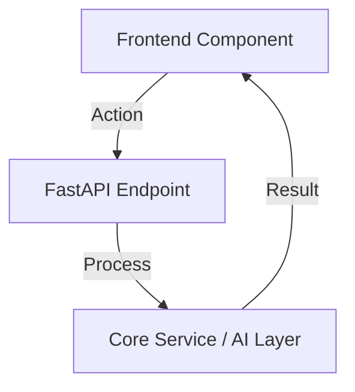

# Tutorial Template: Lesson [XX] - [Lesson Title]

> **Branch Checkpoints**:
> - Starter Code: `git checkout lesson-[XX]-starter`
> - Reference Solution: `git checkout lesson-[XX]-solution`

---

## 1. Lesson Overview & Architecture

Brief 2-3 sentence summary of what learners will build in this lesson and the core minimum viable product (MVP) delivered upon completion.

### Architecture Diagram


---

## 2. Core AI Engineering Concept Explained

In-depth pedagogical breakdown of the concept:
- **What is it?** (Theoretical foundation)
- **Why do we need it?** (The problem it solves in production AI engineering)
- **Production Trade-offs** (Latency vs Cost vs Accuracy)

---

## 3. Step-by-Step Build Walkthrough

### Step 3.1: Environment & File Preparation
Terminal commands to run before editing code:
```bash
# Example terminal command
git checkout lesson-[XX]-starter
```

### Step 3.2: Implementing [Core Backend Service / Schema]
Detailed line-by-line annotated code walkthrough:

```python
# backend/example/path.py
"""
Educational Module Docstring:
Explain the purpose of this file and its role in the architecture.
"""

from pydantic import BaseModel, Field


class ExampleDataSchema(BaseModel):
    """
    Descriptive schema modeling the incoming AI response.
    Each field contains validation rules to prevent hallucinations.
    """
    example_field_name: str = Field(
        ..., 
        description="Clear description of this property for LLM tool binding"
    )
```

### Step 3.3: Connecting the Frontend Interface
Detailed line-by-line annotated TypeScript/React walkthrough.

---

## 4. Testing & Verification Gate

Run these exact terminal commands to verify your implementation:

```bash
# Run the automated backend test suite for this lesson
pytest backend/tests/test_lesson_[XX].py -v

# Run the frontend component tests
cd frontend && npm run test
```

### Expected Output
```
backend/tests/test_lesson_[XX].py::test_successful_execution PASSED [100%]
1 passed in 0.42s
```

---

## 5. Common Pitfalls & Debugging Guide

| Issue / Error Message | Root Cause | How to Fix |
| :--- | :--- | :--- |
| `ConnectionRefusedError: [Errno 111]` | Ollama daemon is not running locally. | Run `ollama serve` in a separate terminal. |
| `ValidationError: field required` | LLM omitted a required field in the JSON response. | Adjust temperature down to 0.1 or refine the system prompt schema. |

---

## 6. Self-Study Challenge

An optional exercise to push your skills further:
- **Challenge**: [Describe the challenge scenario]
- **Hint**: [Provide a constructive hint without giving away the complete solution]
