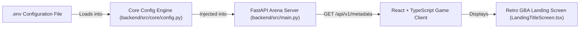

# Tutorial: Lesson 00 - Full-Stack Foundations, .env Configuration & Landing Title Screen

> **Branch Checkpoints**:
> - Starter Code: `git checkout lesson-00-starter`
> - Reference Solution: `git checkout lesson-00-solution`

---

## 1. Lesson Overview & Architecture

In this foundational lesson, we establish the stadium grounds for **PokeAI Arena**. Before our Game Guide can step into the coaching box or our AI battle agents can trade blows, we must construct a rock-solid, type-safe full-stack communication bridge between our Python 3.12 (FastAPI) arena backend and our React 18 / TypeScript (Vite) battle client.

By the end of this lesson, you will have a live retro Game Boy Advance landing screen dynamically loading stadium metadata (`GAME_TITLE`, `VERSION`, `PROJECT_GOAL`, `GAME_DESCRIPTION`, `GAME_GUIDE`) directly from an isolated `.env` configuration file via a strictly validated REST endpoint.

### Architecture Diagram



---

## 2. Core AI Engineering Concept Explained

### The Stadium Ground Rules: 12-Factor Centralized Configuration

In traditional software development, configuration errors cause minor UI glitches. In **AI Engineering**, improper configuration can lead to catastrophic failures: leaking private LLM API keys, sending high-rate inference calls to expensive cloud models during automated unit testing, or experiencing mysterious cross-origin blocking when connecting browser clients to local neural servers.

#### 1. Why Do We Need Centralized Configuration?
Imagine organizing a monster battle tournament where every referee, coach, and scorekeeper has a different printed rulebook. Chaos ensues! 

In production AI systems:
- We swap models dynamically between environments: local Ollama (`llama3.2`) during development, blazing-fast Groq (`llama-3.1-8b-instant`) in staging, and high-reasoning Gemini (`gemini-2.0-flash`) in production.
- Isolating environment variables in a single `.env` file and reading them through a single source of truth ([`config.py`](file:///c:/Users/roeld.JAYMIE-DESKTOP/Desktop/CODE/projects/PokeAI/backend/src/core/config.py)) ensures that no file ever hardcodes a sensitive credential or hardcoded domain origin.

#### 2. The Strict Boundary Handshake: Pydantic v2 & TypeScript
AI endpoints produce structured outputs that must be consumed reliably by the frontend. By defining a **Pydantic v2 BaseModel** on the referee server and matching TypeScript interfaces on the client, we establish an immutable boundary. If the backend changes a field name, our type checker flags it before the code ever reaches production.

---

## 3. Step-by-Step Build Walkthrough

### Step 3.1: Environment & File Preparation

Create the backend virtual environment and install core dependencies:

```bash
# Navigate to the workspace root
cd PokeAI

# Create dedicated Python 3.12+ virtual environment
python -m venv backend/.venv

# Activate the virtual environment
# Windows (PowerShell):
.\backend\.venv\Scripts\Activate.ps1
# macOS/Linux:
source backend/.venv/bin/activate

# Install required dependencies
pip install -r backend/requirements.txt
```

### Step 3.2: Implementing the Centralized Config & Schema

Create `backend/.env` with your stadium parameters:

```dotenv
# backend/.env
APP_ENV=local
VERSION="0.1.0"
PROJECT_GOAL="AI Engineering Path while building a turn-based monster battler game."
GAME_TITLE="PokeAI"
GAME_DESCRIPTION="A turn-based monster battler engineered step-by-step to master AI Engineering principles."
GAME_GUIDE="Shaneil"
BACKEND_CORS_ORIGINS=["http://localhost:5173", "http://127.0.0.1:5173"]
```

Next, implement `backend/src/core/config.py` to parse and sanitize settings with safe CORS fallbacks:

```python
# backend/src/core/config.py
import json
import logging
import os
from pathlib import Path
from dotenv import load_dotenv

# Mute noisy HTTP and networking logs
logging.getLogger("httpx").setLevel(logging.WARNING)

# Resolve path to backend root and load .env
backend_directory_path = Path(__file__).resolve().parent.parent.parent
environment_file_path = backend_directory_path / ".env"
load_dotenv(dotenv_path=environment_file_path)

# Extract environment settings
application_environment = os.getenv("APP_ENV", "local")
game_version = os.getenv("VERSION", "0.1.0")
project_learning_goal = os.getenv("PROJECT_GOAL", "AI Engineering Path while building a turn-based monster battler game.")
game_title = os.getenv("GAME_TITLE", "PokeAI")
game_description = os.getenv("GAME_DESCRIPTION", "A turn-based monster battler engineered step-by-step to master AI Engineering principles.")
game_guide_name = os.getenv("GAME_GUIDE", "Athena")

# Parse CORS origins with fallback support for JSON lists or comma-separated strings
raw_origins_environment_variable = os.getenv("BACKEND_CORS_ORIGINS", "")
if raw_origins_environment_variable:
    try:
        backend_cors_origins = json.loads(raw_origins_environment_variable)
    except Exception:
        backend_cors_origins = [
            origin.strip().strip("'\"[] ")
            for origin in raw_origins_environment_variable.split(",")
            if origin.strip()
        ]
else:
    backend_cors_origins = ["http://localhost:5173", "http://127.0.0.1:5173"]
```

Define the metadata contract schema in `backend/src/schemas/metadata_schema.py`:

```python
# backend/src/schemas/metadata_schema.py
from pydantic import BaseModel, ConfigDict, Field


class GameMetadataResponse(BaseModel):
    model_config = ConfigDict(extra="forbid")

    application_environment: str = Field(..., description="Environment classification e.g. local")
    game_version: str = Field(..., description="Semver game version e.g. 0.1.0")
    project_learning_goal: str = Field(..., description="High-level pedagogical mission statement")
    game_title: str = Field(..., description="Title of the game: PokeAI")
    game_description: str = Field(..., description="Tagline description of the game experience")
    game_guide_name: str = Field(..., description="Name of the game guide loaded dynamically from environment")
```

### Step 3.3: Connecting the Frontend Interface & Reusable UI Components

To maintain scalability across all 12 lessons, we establish a clean **component hierarchy**:
- `frontend/src/components/screen/`: Stage & full-screen views (e.g. `LandingTitleScreen.tsx`).
- `frontend/src/components/ui/`: Reusable atomic widgets (e.g. `CharacterUI.tsx`, `ButtonUI.tsx`).

1. Define matching TypeScript interfaces in `frontend/src/types/metadata.ts`:

```typescript
export interface GameMetadataResponse {
  application_environment: string;
  game_version: string;
  project_learning_goal: string;
  game_title: string;
  game_description: string;
  game_guide_name: string;
}
```

2. Build the reusable animated character component `frontend/src/components/ui/CharacterUI.tsx`:

```tsx
// frontend/src/components/ui/CharacterUI.tsx
import React from "react";

export interface CharacterUIProps {
  pokemonNationalPokedexId?: number | string;
  customSpriteUrl?: string;
  characterAltDescription?: string;
  pixelDimensionSize?: number;
  shouldDisplayPedestalShadow?: boolean;
  additionalClassName?: string;
}

export const CharacterUI: React.FC<CharacterUIProps> = ({
  pokemonNationalPokedexId = 25,
  customSpriteUrl,
  characterAltDescription = "Animated Pokémon Mascot Sprite",
  pixelDimensionSize = 96,
  shouldDisplayPedestalShadow = true,
  additionalClassName = "",
}) => {
  const resolvedSpriteUrl =
    customSpriteUrl ||
    `https://raw.githubusercontent.com/PokeAPI/sprites/master/sprites/pokemon/versions/generation-v/black-white/animated/${pokemonNationalPokedexId}.gif`;

  return (
    <div className={`mascot-sprite-container ${additionalClassName}`}>
      
      {shouldDisplayPedestalShadow && (
        <div
          className="mascot-pedestal-shadow"
          style={{ width: `${Math.round(pixelDimensionSize * 0.75)}px` }}
        />
      )}
    </div>
  );
};
```

3. Build the authentic Pokémon GBA menu button `frontend/src/components/ui/ButtonUI.tsx`:

```tsx
// frontend/src/components/ui/ButtonUI.tsx
import React from "react";

export interface ButtonUIProps {
  children: React.ReactNode;
  onClick?: () => void;
  type?: "button" | "submit" | "reset";
  variant?: "default" | "action" | "subtle";
  showArrowPointer?: "left" | "right" | "both" | "none";
  disabled?: boolean;
  additionalClassName?: string;
  title?: string;
}

export const ButtonUI: React.FC<ButtonUIProps> = ({
  children,
  onClick,
  type = "button",
  variant = "default",
  showArrowPointer = "none",
  disabled = false,
  additionalClassName = "",
  title,
}) => {
  const showLeftArrow = showArrowPointer === "left" || showArrowPointer === "both";
  const showRightArrow = showArrowPointer === "right" || showArrowPointer === "both";

  return (
    <button
      type={type}
      onClick={onClick}
      disabled={disabled}
      title={title}
      className={`pokemon-retro-button pokemon-button-${variant} ${additionalClassName}`}
    >
      {showLeftArrow && <span className="pokemon-btn-arrow pokemon-btn-arrow-left">▶</span>}
      <span className="pokemon-btn-label">{children}</span>
      {showRightArrow && <span className="pokemon-btn-arrow pokemon-btn-arrow-right">◀</span>}
    </button>
  );
};
```

4. Assemble `frontend/src/components/screen/LandingTitleScreen.tsx`:
Integrates the asynchronous REST handshake, embeds `<CharacterUI />` and `<ButtonUI />`, and adopts the **Daylight Stadium Light Palette** with a centered `960px` max-width chassis.

---

## 4. Testing & Verification Gate

Run these exact commands from your terminal to verify that the backend configuration and API contract are 100% sound:

```bash
# Set PYTHONPATH and run backend automated tests
$env:PYTHONPATH="backend"
.\backend\.venv\Scripts\pytest backend\tests\test_config.py -v
```

### Expected Output
```text
backend/tests/test_config.py::test_configuration_values_loaded PASSED    [ 33%]
backend/tests/test_config.py::test_get_metadata_endpoint_success PASSED  [ 66%]
backend/tests/test_config.py::test_root_status_endpoint PASSED           [100%]

======================== 3 passed in 0.76s =========================
```

Verify frontend TypeScript compilation:

```bash
cd frontend
npm run build
```

---

## 5. Common Pitfalls & Debugging Guide

| Issue / Error Message | Root Cause | How to Fix |
| :--- | :--- | :--- |
| `CORS Error: Access to fetch has been blocked` | Frontend origin (`http://localhost:5173`) missing from `BACKEND_CORS_ORIGINS`. | Inspect `backend/.env` and ensure `BACKEND_CORS_ORIGINS=["http://localhost:5173", "http://127.0.0.1:5173"]` is present and restarted. |
| `ValidationError: Extra inputs are not permitted` | Frontend or backend returned an undeclared key with `extra="forbid"`. | Synchronize the Pydantic schema and JSON payloads strictly. |
| `AssertionError: assert 'Athena' == 'Shaneil'` | Unit test hardcoded a static guide name instead of dynamically asserting `.env` synchronization. | In `test_config.py`, assert `response_payload["game_guide_name"] == config.game_guide_name` to validate true environment-driven contract binding. |
| `TypeError: Failed to fetch` | FastAPI backend is not running on port 8000. | Run `uvicorn src.main:app --reload --port 8000` from the `backend/` directory. |

---

## 6. Self-Study Challenge

- **Challenge**: Add a dynamic latency benchmark badge on the landing screen that measures the round-trip HTTP handshake duration in milliseconds between the browser and the FastAPI referee.
- **Hint**: Use `performance.now()` immediately before calling `fetchStadiumGameMetadata()` and measure `const durationMilliseconds = Math.round(performance.now() - startTime)`. Display the result alongside the `FastAPI Referee Ready` status indicator!
