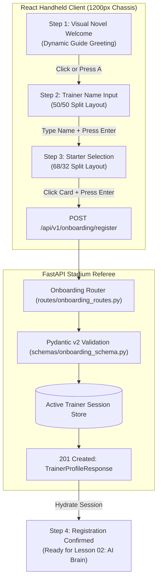

# Tutorial: Lesson 01 - Game Guide Onboarding, Client-Server State Machines & Starter Selection

> **Branch Checkpoints**:
> - Starter Code: `git checkout lesson-01-starter`
> - Reference Solution: `git checkout lesson-01-solution`

---

## 1. Lesson Overview & Architecture

In **Lesson 00**, we established the stadium foundations: configuring `.env` boundaries, connecting the FastAPI arena referee, and verifying the handshake across the retro title screen.

In **Lesson 01**, the player steps onto the tournament registration concourse. Before any AI battle agent can compute offensive damage or tactical advice, the arena system must establish a validated, type-safe **Trainer Profile** through a deterministic client-server state machine.

By the end of this lesson, you will have implemented:
1. A **Pydantic v2 intake contract** and FastAPI onboarding router (`/api/v1/onboarding/starters` and `/api/v1/onboarding/register`).
2. An authentic JRPG visual novel dialogue engine (`GameGuideDialogBox.tsx`) with character overlay, frosted glassmorphism, dynamic metadata nameplate, and retro typewriter streaming.
3. A 3-step onboarding flow (Welcome $\rightarrow$ Name Input with 50/50 split $\rightarrow$ Starter Selection with 68/32 split and <kbd>Enter</kbd> confirmation).

### Architecture Diagram



---

## 2. Core AI Engineering Concepts Explained

### The Stadium Analogy: Registration Before Combat
Imagine walking into a high-stakes monster battle arena:
- You cannot challenge gym leaders or request tactical coaching without an official **Trainer Card**.
- If a trainer presents malformed identification or an unapproved monster ID, the tournament referee rejects the entry badge at the gate with **HTTP 422 Unprocessable Entity** or **HTTP 400 Bad Request**.

### Technical Pillars in Production AI Engineering

#### 1. Input Sanitization & Guardrails Before Downstream Prompts
In AI Engineering, garbage in produces hallucinations out. An LLM cannot reason reliably if the player's name is 10,000 characters long, contains script injection, or if the monster ID does not map to a registered vector embeddings document. By validating the intake schema via Pydantic v2 (`min_length=2, max_length=20`, valid starter IDs), we build an immutable firewall before user input ever enters a prompt template.

#### 2. Client-Server Finite State Machines (FSM)
Production AI conversational agents rely on strictly bounded state transitions:
$$\text{WELCOME} \xrightarrow{\text{press A}} \text{NAME\_INPUT} \xrightarrow{\text{submit name}} \text{STARTER\_SELECT} \xrightarrow{\text{register}} \text{BATTLE\_READY}$$
Each screen transition is deterministic, guarded against race conditions, and synchronized with server-side validation.

#### 3. Reusable Visual Novel Overlay Architecture
Dialogue boxes in modern game clients must support dynamic text streaming, character image placement (left/right), frosted glassmorphism for backdrop blending, and dual-click interactions (skip-to-end when typing, advance when finished).

---

## 3. Step-by-Step Build Walkthrough

### Step 3.1: Define Backend Pydantic Schemas (`backend/src/schemas/onboarding_schema.py`)

Create the data contracts defining the starter catalog and registration payloads:

```python
"""
Onboarding Schema Module
Defines Pydantic v2 data models for starter monster catalogs and trainer registration contracts.
"""

from pydantic import BaseModel, ConfigDict, Field


class StarterMonsterInfo(BaseModel):
    """
    Structured data representation of a starter monster available for selection.
    """

    model_config = ConfigDict(
        extra="forbid",
        json_schema_extra={
            "example": {
                "starter_pokemon_id": 4,
                "monster_name": "Charmander",
                "elemental_types": ["Fire"],
                "starter_description": "Obviously prefers hot places.",
                "base_hit_points": 39,
                "base_attack_power": 52,
                "base_defense_rating": 43,
                "base_speed_velocity": 65,
                "front_sprite_url": "https://raw.githubusercontent.com/PokeAPI/sprites/master/sprites/pokemon/4.png",
            }
        },
    )

    starter_pokemon_id: int = Field(..., description="Official Pokédex numerical identifier")
    monster_name: str = Field(..., description="Display name of the monster")
    elemental_types: list[str] = Field(..., description="Elemental typing (e.g. Grass, Fire, Water)")
    starter_description: str = Field(..., description="Pokédex lore entry")
    base_hit_points: int = Field(..., gt=0)
    base_attack_power: int = Field(..., gt=0)
    base_defense_rating: int = Field(..., gt=0)
    base_speed_velocity: int = Field(..., gt=0)
    front_sprite_url: str = Field(..., description="Public sprite URL")


class TrainerRegistrationRequest(BaseModel):
    """
    Intake payload submitted by the player when locking in name and starter choice.
    """

    model_config = ConfigDict(extra="forbid")

    trainer_name: str = Field(..., min_length=2, max_length=20, description="Trainer name")
    selected_starter_id: int = Field(..., description="ID of chosen starter (1, 4, or 7)")


class TrainerProfileResponse(BaseModel):
    """
    Confirmed tournament registration card returned after successful onboarding.
    """

    model_config = ConfigDict(extra="forbid")

    trainer_registration_id: str
    trainer_name: str
    selected_starter_monster: StarterMonsterInfo
    victories_count: int = 0
    stat_progression_multiplier: float = 1.0
    created_at_timestamp: str
```

### Step 3.2: Implement the Onboarding Router (`backend/src/routes/onboarding_routes.py`)

Serve the 3 starters and register the trainer profile in memory:

```python
"""
Onboarding Routes Module
Handles starter monster catalogs and trainer registration workflows.
"""

from datetime import datetime, timezone
import uuid
from fastapi import APIRouter, HTTPException, status
from src.schemas.onboarding_schema import (
    StarterMonsterInfo,
    TrainerProfileResponse,
    TrainerRegistrationRequest,
)

onboarding_router = APIRouter(prefix="/api/v1/onboarding", tags=["Trainer Onboarding"])

AVAILABLE_STARTER_MONSTERS_CATALOG: dict[int, StarterMonsterInfo] = {
    1: StarterMonsterInfo(
        starter_pokemon_id=1,
        monster_name="Bulbasaur",
        elemental_types=["Grass", "Poison"],
        starter_description="A strange seed was planted on its back at birth.",
        base_hit_points=45,
        base_attack_power=49,
        base_defense_rating=49,
        base_speed_velocity=45,
        front_sprite_url="https://raw.githubusercontent.com/PokeAPI/sprites/master/sprites/pokemon/1.png",
    ),
    4: StarterMonsterInfo(
        starter_pokemon_id=4,
        monster_name="Charmander",
        elemental_types=["Fire"],
        starter_description="Obviously prefers hot places.",
        base_hit_points=39,
        base_attack_power=52,
        base_defense_rating=43,
        base_speed_velocity=65,
        front_sprite_url="https://raw.githubusercontent.com/PokeAPI/sprites/master/sprites/pokemon/4.png",
    ),
    7: StarterMonsterInfo(
        starter_pokemon_id=7,
        monster_name="Squirtle",
        elemental_types=["Water"],
        starter_description="Shoots water at prey while in the water.",
        base_hit_points=44,
        base_attack_power=48,
        base_defense_rating=65,
        base_speed_velocity=43,
        front_sprite_url="https://raw.githubusercontent.com/PokeAPI/sprites/master/sprites/pokemon/7.png",
    ),
}

STARTER_INDEX_TO_POKEDEX_ID_MAPPING: dict[int, int] = {1: 1, 2: 4, 3: 7}
active_trainer_registration_store: dict[str, TrainerProfileResponse] = {}


@onboarding_router.get("/starters", response_model=list[StarterMonsterInfo])
async def get_available_starter_monsters() -> list[StarterMonsterInfo]:
    return list(AVAILABLE_STARTER_MONSTERS_CATALOG.values())


@onboarding_router.post("/register", response_model=TrainerProfileResponse, status_code=status.HTTP_201_CREATED)
async def register_trainer_profile(registration_request: TrainerRegistrationRequest) -> TrainerProfileResponse:
    requested_id = registration_request.selected_starter_id
    resolved_id = requested_id if requested_id in AVAILABLE_STARTER_MONSTERS_CATALOG else STARTER_INDEX_TO_POKEDEX_ID_MAPPING.get(requested_id)

    if resolved_id is None or resolved_id not in AVAILABLE_STARTER_MONSTERS_CATALOG:
        raise HTTPException(
            status_code=status.HTTP_400_BAD_REQUEST,
            detail=f"Invalid starter ID: {requested_id}. Must be 1, 4, or 7.",
        )

    registered_profile = TrainerProfileResponse(
        trainer_registration_id=f"trainer-{uuid.uuid4().hex[:8]}",
        trainer_name=registration_request.trainer_name.strip(),
        selected_starter_monster=AVAILABLE_STARTER_MONSTERS_CATALOG[resolved_id],
        victories_count=0,
        stat_progression_multiplier=1.0,
        created_at_timestamp=datetime.now(timezone.utc).isoformat(),
    )
    active_trainer_registration_store[registered_profile.trainer_registration_id] = registered_profile
    return registered_profile
```

### Step 3.3: Mount Router in `backend/src/main.py`

```python
from src.routes.onboarding_routes import onboarding_router

# In create_pokeai_application():
pokeai_application.include_router(metadata_router)
pokeai_application.include_router(onboarding_router)
```

---

## 4. Testing & Verification Gate

Run the automated pytest test suite:

```bash
# Windows PowerShell
.\backend\.venv\Scripts\pytest backend/tests/test_onboarding.py -v
```

Expected Output:
```text
backend/tests/test_onboarding.py::test_get_available_starters_returns_three_monsters PASSED [ 25%]
backend/tests/test_onboarding.py::test_register_trainer_profile_success PASSED [ 50%]
backend/tests/test_onboarding.py::test_register_trainer_fails_on_invalid_starter_id PASSED [ 75%]
backend/tests/test_onboarding.py::test_register_trainer_fails_on_short_name PASSED [100%]
============================== 4 passed in 0.55s ==============================
```

Frontend Verification:
```bash
npm --prefix frontend run build
```
Expected Output:
```text
✓ built in 240ms (0 errors)
```

---

## 5. Summary of Implemented Features

| Feature | Implementation File | AI Engineering Purpose |
|---|---|---|
| **Intake Contracts** | `schemas/onboarding_schema.py` | Enforces parameter guardrails before downstream prompt injection |
| **Catalog & Registration API** | `routes/onboarding_routes.py` | Ingests validated trainer and monster entity into memory |
| **Typewriter Dialogue Engine** | `components/ui/GameGuideDialogBox.tsx` | Retro text streaming (20ms/char) with skip-or-advance interaction |
| **Translucent Frosted Glass** | `index.css` (`.dialogue-frame-chassis`) | `rgba(255, 255, 255, 0.65)` glassmorphism with `backdrop-filter: blur(8px)` |
| **Kitsune Fox-Ear Guide Sprite** | `assets/guide_character.png` | Transparent PNG character asset with instructional coaching gesture |
| **Step 2: 50/50 Split Layout** | `components/screen/PlayerNameInputScreen.tsx` | Clean input card on left, open stage on right for elevated guide |
| **Step 3: 68/32 Split Layout** | `components/screen/StarterSelectionScreen.tsx` | 3 cards on left, guide on right; zero card overlap; Enter to confirm |
| **Player Name Highlight Badge** | `StarterSelectionScreen.tsx` & `GameGuideDialogBox.tsx` | Highlights trainer name in header badge (`.trainer-name-highlight-badge`) and inline speech (`highlightedTerm`) |
| **Dynamic Guide Name** | `App.tsx` $\rightarrow$ `config.py` | Fetches `game_guide_name` metadata dynamically from backend `.env` |
| **Uniform 1200px & Responsive CSS** | `index.css` (`#root`, `.pokeai-viewport`, `@media`) | Locked 1200px desktop chassis + pure-CSS Tablet (`<= 1024px`) & Mobile (`<= 768px`, `<= 480px`) breakpoints with elevated character positioning |

---

## 6. Self-Study Challenge

- **Challenge**: Add audio feedback! Use the Web Audio API to play a short 8-bit synthetic bleep sound on every character typed by the typewriter effect.
- **Hint**: Construct a lightweight `AudioContext` with an `OscillatorNode` pulsing at 440Hz for 15 milliseconds.
