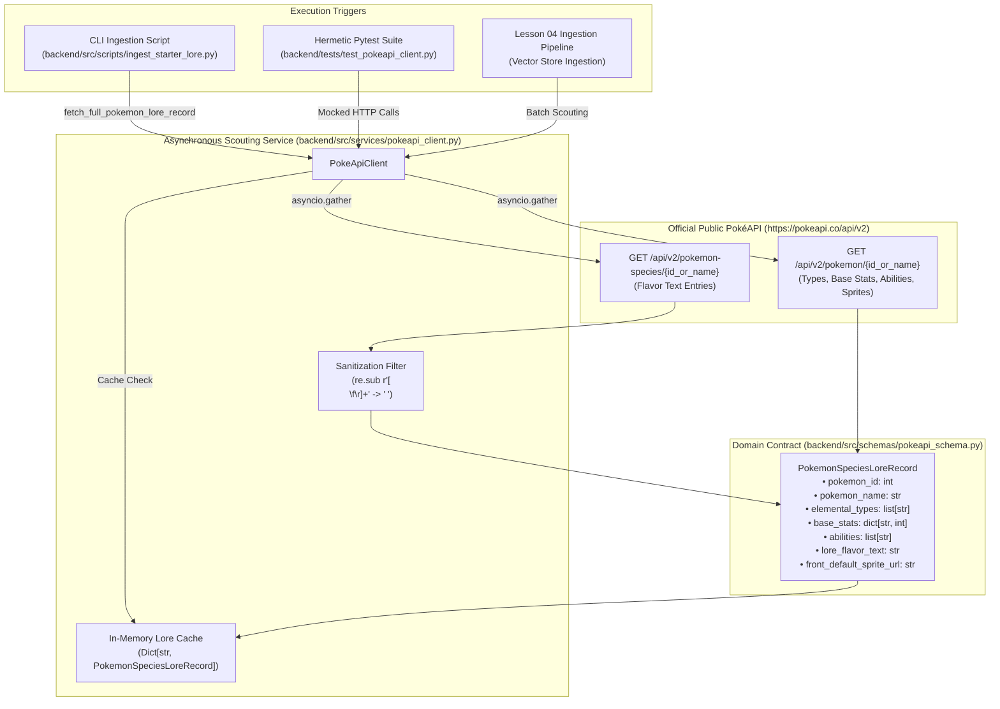

# Tutorial: Lesson 03 - The Pokémon Researcher's Telescope (Async PokéAPI Ingestion)

> **Branch Checkpoints**:
> - Starter Code: `git checkout lesson-03-starter`
> - Reference Solution: `git checkout lesson-03-solution`

---

## 1. Lesson Overview & Architecture

In **Lesson 02**, our Game Guide's AI Brain officially awakened through the Three-Channel Resilient LLM Gateway (Ollama, Groq, and Gemini).

In **Lesson 03**, we step outside the stadium walls to build the **Academy Researcher's Telescope**: an asynchronous external ingestion client powered by `httpx.AsyncClient` and `pydantic` v2. Rather than relying on hardcoded static dictionaries, our system reaches out to the official public [PokéAPI](https://pokeapi.co/) to dynamically harvest:
1. **Combat Statistics** (`/api/v2/pokemon/{id}`): Base HP, Attack, Defense, Special Attack, Special Defense, Speed, Elemental Types, and Abilities.
2. **Species Lore** (`/api/v2/pokemon-species/{id}`): Canonical English Pokédex flavor text describing the creature's personality and natural habitat.

To prevent freezing the stadium referee engine while downloading web data, we use non-blocking concurrency (`asyncio.gather`), sanitize legacy text formatting (removing old Game Boy `\f` and `\n` control characters), and implement an in-memory cache to respect public API quotas.

### Architecture Diagram



---

## 2. Core AI Engineering Concepts Explained

### The Stadium Metaphor: The Scouting Telescope
Before an expedition into tall grass or a high-stakes arena showdown, the Pokémon Academy researcher sets up a high-magnification scouting telescope. 

Instead of sending one scout runner who walks to the Pokémon center for combat metrics, walks back, and then runs across town to the library for species lore sequentially (doubling latency), the researcher uses high-speed two-way radio channels to dispatch both scouts concurrently. Both scouting reports arrive in parallel, and the researcher logs the unified findings into the field Pokédex before the match begins.

### Technical Pillars in Production AI Engineering

#### 1. Non-Blocking Asynchronous I/O with `httpx`
In production Python AI engineering, synchronous blocking libraries like standard `requests` block the Python GIL (Global Interpreter Lock) event loop while awaiting remote TCP handshakes and payload downloads. Utilizing `httpx.AsyncClient` keeps the FastAPI referee server responsive to user interactions while remote requests travel across the internet.

#### 2. Concurrent Request Coalescing (`asyncio.gather`)
Each target monster requires two separate REST resources from PokéAPI: the combat entity and the species entity. Running them sequentially:
$$\text{Latency} = T_{\text{combat}} + T_{\text{species}} \approx 300\text{ms} + 300\text{ms} = 600\text{ms}$$
Using `asyncio.gather`:
$$\text{Latency} = \max(T_{\text{combat}}, T_{\text{species}}) \approx 300\text{ms}$$
This cuts external round-trip overhead in half.

#### 3. Data Cleaning for Embedding Pipelines
Old Game Boy ROM texts in PokéAPI contain legacy formatting artifacts such as page-break form feeds (`\f`), carriage returns (`\r`), and erratic mid-sentence line breaks (`\n`). If fed directly into LLMs or vector embedding models, these tokens corrupt semantic proximity calculations in cosine distance. Normalizing whitespace ensures high-quality embeddings in **Lesson 04**.

#### 4. Hermetic Testing & External API Decoupling
Production test suites must **never** make live network requests to third-party APIs during CI/CD. Doing so introduces network flakiness, rate limit blocks (HTTP 429), and non-deterministic failures. We mock `httpx.AsyncClient.get` with standard `unittest.mock` objects to guarantee instant, repeatable test execution.

---

## 3. Step-by-Step Build Walkthrough

### Step 3.1: Defining Pydantic v2 Domain Models
Create [`backend/src/schemas/pokeapi_schema.py`](file:///c:/Users/roeld.JAYMIE-DESKTOP/Desktop/CODE/projects/PokeAI/backend/src/schemas/pokeapi_schema.py):

```python
from typing import Dict, List, Optional
from pydantic import BaseModel, Field, ConfigDict


class PokemonCombatStats(BaseModel):
    """
    Standardized combat metrics extracted from raw PokéAPI combat data.
    Ensures that battle calculations in Lesson 05 always receive integers.
    """
    model_config = ConfigDict(extra="ignore")

    hit_points: int = Field(..., description="The base health points of the monster")
    attack: int = Field(..., description="Base physical attack damage output")
    defense: int = Field(..., description="Base physical damage reduction")
    special_attack: int = Field(..., description="Base special attack power")
    special_defense: int = Field(..., description="Base special defense resistance")
    speed: int = Field(..., description="Speed metric deciding turn order")


class PokemonSpeciesLoreRecord(BaseModel):
    """
    Unified domain model combining combat parameters and natural language lore.
    This is the exact contract stored in ChromaDB vector memory in Lesson 04.
    """
    model_config = ConfigDict(extra="ignore")

    pokemon_id: int = Field(..., description="Canonical National Pokédex integer identifier")
    pokemon_name: str = Field(..., description="Lowercase canonical monster identifier name")
    elemental_types: List[str] = Field(default_factory=list, description="List of elemental type categories")
    base_stats: Dict[str, int] = Field(default_factory=dict, description="Dictionary mapping stat names to values")
    abilities: List[str] = Field(default_factory=list, description="List of passive battle capabilities")
    lore_flavor_text: str = Field(..., description="Sanitized English species lore description for vector embeddings")
    front_default_sprite_url: Optional[str] = Field(default=None, description="Direct URL to monster front sprite")
```

### Step 3.2: Implementing the Asynchronous Client Service
Create [`backend/src/services/pokeapi_client.py`](file:///c:/Users/roeld.JAYMIE-DESKTOP/Desktop/CODE/projects/PokeAI/backend/src/services/pokeapi_client.py):
- Implement `sanitize_lore_flavor_text` to strip form-feeds and collapse whitespace.
- Implement `fetch_pokemon_combat_data` and `fetch_pokemon_species_lore` with strict HTTP status code checking.
- Implement `fetch_full_pokemon_lore_record` using `asyncio.gather` for non-blocking concurrent harvesting and in-memory caching.

### Step 3.3: Creating the CLI Ingestion Utility
Create [`backend/src/scripts/ingest_starter_lore.py`](file:///c:/Users/roeld.JAYMIE-DESKTOP/Desktop/CODE/projects/PokeAI/backend/src/scripts/ingest_starter_lore.py):
- Script dynamically imports `PokeApiClient` and queries `["bulbasaur", "charmander", "squirtle", "pidgey"]`.
- Prints formatted stadium scouting cards for terminal verification.

### Step 3.4: Automated Mock Test Suite
Create [`backend/tests/test_pokeapi_client.py`](file:///c:/Users/roeld.JAYMIE-DESKTOP/Desktop/CODE/projects/PokeAI/backend/tests/test_pokeapi_client.py):
- Unit test for text sanitization (`\f` and `\n` handling).
- Async mock test verifying concurrent harvesting and domain normalization.
- 404 Not Found exception handling test.
- In-memory cache hit test confirming zero redundant network calls on duplicate queries.

---

## 4. Testing & Verification Gate

Run these exact terminal commands to verify your implementation:

```powershell
# 1. Run the targeted PokéAPI test suite
.\backend\.venv\Scripts\pytest.exe .\backend\tests\test_pokeapi_client.py -v

# 2. Run the entire backend test suite (16 tests across config, gateway, onboarding, and PokéAPI)
.\backend\.venv\Scripts\pytest.exe .\backend\tests -v

# 3. Execute the live async scouting CLI against PokéAPI
.\backend\.venv\Scripts\python.exe .\backend\src\scripts\ingest_starter_lore.py
```

### Expected Output
```text
============================= 16 passed in 10.03s =============================
backend/tests/test_config.py ......... [3 passed]
backend/tests/test_llm_gateway.py ..... [5 passed]
backend/tests/test_onboarding.py ...... [4 passed]
backend/tests/test_pokeapi_client.py .. [4 passed]
```
