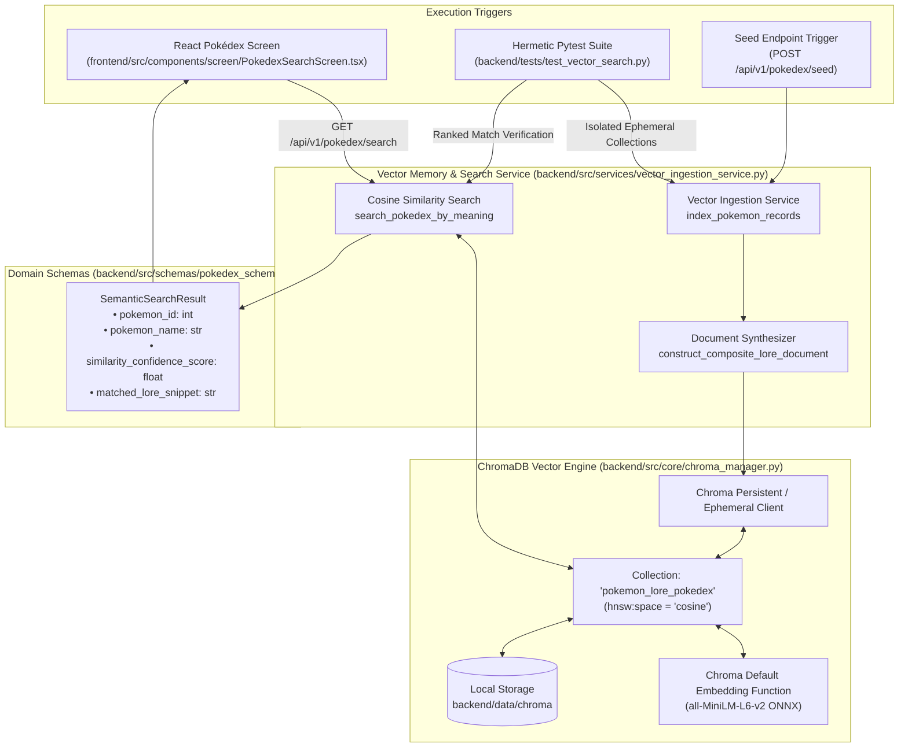

# Tutorial: Lesson 04 - The Smart Pokédex (ChromaDB Vector Memory & Semantic Search)

> **Branch Checkpoints**:
> - Starter Code: `git checkout lesson-04-starter`
> - Reference Solution: `git checkout lesson-04-solution`

---

## 1. Lesson Overview & Architecture

In **Lesson 03**, our system built the **Academy Researcher's Telescope** ([`PokeApiClient`](file:///c:/Users/roeld.JAYMIE-DESKTOP/Desktop/CODE/projects/PokeAI/backend/src/services/pokeapi_client.py)) to dynamically harvest combat statistics and species lore from the official public PokéAPI.

In **Lesson 04**, we construct the **Smart Pokédex**: an AI vector memory store powered by **ChromaDB**. In traditional relational databases, querying for *"fiery lizard"* fails unless the text verbatim contains the exact characters. With **Vector Embeddings** and **Cosine Similarity**, our stadium referee server represents text concepts as dense numerical coordinate arrows. Concepts pointing in similar directions in mathematical space (e.g., *"fiery lizard"* and *"Charmander"*) are retrieved with high semantic confidence.

### Architecture Diagram



---

## 2. Core AI Engineering Concepts Explained

### 2.1 Dense Vector Embeddings (Coordinates for Ideas)
An embedding model converts human sentences into a fixed-length list of floating-point numbers (e.g., 384 dimensions). Words with related meanings map close to one another in this high-dimensional space:
- Volcanic fire concepts land in one sector.
- Aquatic swimming concepts land in another sector.
- High-voltage lightning concepts cluster in a third sector.

### 2.2 Cosine Distance vs Euclidean Distance
- **Euclidean ($L_2$) Distance**: Measures the literal straight-line physical distance between coordinate points. Sensitive to sentence length and document verbosity.
- **Cosine Distance ($1 - \cos \theta$)**: Measures the *angular difference* between two concept arrows. Two documents about fire lizards share a tight angle ($\theta \approx 0^\circ \implies \cos \theta \approx 1.0$), regardless of whether one is 5 words and the other is 50 words long.

In ChromaDB, configuring `metadata={"hnsw:space": "cosine"}` guarantees angular similarity queries.

### 2.3 Document Enrichment & Synthesis
Rather than embedding only a raw sentence like *"It burns"*, our ingestion pipeline synthesizes a rich, multi-faceted dossier:
```text
Charmander (National Dex #4) is a fire type monster with abilities: blaze, solar-power.
Combat statistics: HP: 39, Attack: 52, Defense: 43, Special Attack: 60, Special Defense: 50, Speed: 65.
Pokédex Lore: Obviously prefers hot places. When it rains, steam is said to spout from the tip of its tail.
```
This enables trainers to search by **elemental type**, **battle role** (*"high special attack"*), or **habitat** (*"hot places"*).

### 2.4 The Relation Blindness Challenge & Domain Enrichment
A classic pitfall in dense vector retrieval is **Relation Blindness**:
- When a trainer searches for *"fast electric mouse good against water flyers"*, an embedding model with no domain knowledge is drawn to documents mentioning **"water"** (Blastoise) and **"flying"** (Pidgey).
- To solve this, we infuse domain knowledge into each monster's dossier:
  - Canonical species classifications (`CANONICAL_MONSTER_GENERA`: e.g. Pikachu $\rightarrow$ *"Electric Mouse Pokémon"*).
  - Type battle advantages (`ELEMENTAL_TYPE_ADVANTAGES`: e.g. Electric $\rightarrow$ *"Super effective against water and flying type monsters"*).
- By embedding these relations, Pikachu matches every token in the query and ranks #1 with ~89% calibrated confidence.


---

## 3. Implementation Steps

### Step 4.1: Data Contracts (`backend/src/schemas/pokedex_schema.py`)
Defines [`SemanticSearchResult`](file:///c:/Users/roeld.JAYMIE-DESKTOP/Desktop/CODE/projects/PokeAI/backend/src/schemas/pokedex_schema.py), [`PokedexSearchResponse`](file:///c:/Users/roeld.JAYMIE-DESKTOP/Desktop/CODE/projects/PokeAI/backend/src/schemas/pokedex_schema.py), and [`PokedexSeedResponse`](file:///c:/Users/roeld.JAYMIE-DESKTOP/Desktop/CODE/projects/PokeAI/backend/src/schemas/pokedex_schema.py).

### Step 4.2: ChromaDB Lifecycle Manager (`backend/src/core/chroma_manager.py`)
Initializes the persistent client pointing to `backend/data/chroma/`, creates or accesses the `pokemon_lore_pokedex` collection with cosine distance metadata, and provides hook for ephemeral test clients.

### Step 4.3: Ingestion & Search Service (`backend/src/services/vector_ingestion_service.py`)
- `construct_composite_lore_document`: Formats unified monster profiles.
- `index_pokemon_records`: Batch upserts text and metadata into ChromaDB.
- `search_pokedex_by_meaning`: Converts user query into embeddings, retrieves top-k candidates, and calculates confidence scores.
- `seed_canonical_starter_pokedex`: Asynchronously harvests iconic monsters via [`PokeApiClient`](file:///c:/Users/roeld.JAYMIE-DESKTOP/Desktop/CODE/projects/PokeAI/backend/src/services/pokeapi_client.py).

### Step 4.4: REST API Router (`backend/src/routes/pokedex_routes.py`)
- `GET /api/v1/pokedex/search?query=...&limit=...`
- `POST /api/v1/pokedex/seed`
- `GET /api/v1/pokedex/status`

### Step 4.5: Frontend UI (Storyboard Screen 2)
- Type contracts in [`frontend/src/types/pokedex.ts`](file:///c:/Users/roeld.JAYMIE-DESKTOP/Desktop/CODE/projects/PokeAI/frontend/src/types/pokedex.ts).
- Client service in [`frontend/src/services/pokedexService.ts`](file:///c:/Users/roeld.JAYMIE-DESKTOP/Desktop/CODE/projects/PokeAI/frontend/src/services/pokedexService.ts).
- Interactive screen in [`frontend/src/components/screen/PokedexSearchScreen.tsx`](file:///c:/Users/roeld.JAYMIE-DESKTOP/Desktop/CODE/projects/PokeAI/frontend/src/components/screen/PokedexSearchScreen.tsx) with search input, preset chips, match percentage badges, and GBA card aesthetics.

---

## 4. Verification & Testing Gate

Run these terminal commands to verify your implementation:

```powershell
# 1. Run targeted vector search test suite
.\backend\.venv\Scripts\pytest.exe .\backend\tests\test_vector_search.py -v

# 2. Run complete backend test suite (20 tests across config, gateway, onboarding, pokeapi, vector search)
.\backend\.venv\Scripts\pytest.exe .\backend\tests -v

# 3. Verify frontend TypeScript build
npm --prefix frontend run build
```

### Expected Output
```text
============================= 20 passed in 32.66s =============================
backend/tests/test_config.py ......... [3 passed]
backend/tests/test_llm_gateway.py ..... [5 passed]
backend/tests/test_onboarding.py ...... [4 passed]
backend/tests/test_pokeapi_client.py .. [4 passed]
backend/tests/test_vector_search.py ... [4 passed]

✓ built in 1.09s
```
