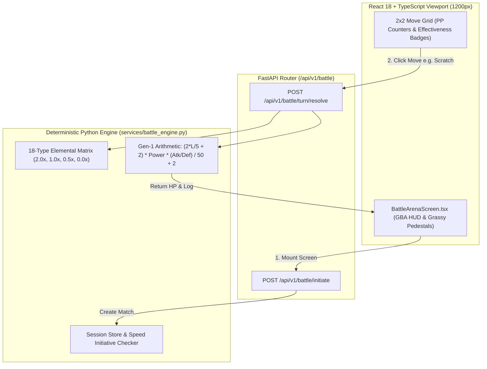

# Tutorial 5: Classic GBA Battle Arena & Deterministic Damage Engine

> **Branch Checkpoints**:
> - Starter Code: `git checkout lesson-05-starter`
> - Reference Solution: `git checkout lesson-05-solution`

---

## 1. Lesson Overview & Architecture

In this lesson, we build the foundation of our turn-based combat system: the **Classic Retro GBA Battle Arena** paired with a **Deterministic Python Damage Engine**.

Before letting AI agents call attacks or commentators narrate moves, we must have an infallible referee. If we let an LLM decide how much damage an attack inflicts, it will hallucinate numbers, miscalculate arithmetic, or invent nonexistent rules. By keeping combat math 100% deterministic in Python, our AI agents (introduced in later lessons) can safely build strategies around real, verified facts.

### Architecture Diagram



---

## 2. Core AI Engineering Concept Explained

### The "Referee vs. Actor" Rule in Production AI Systems

When building AI-powered applications, the most critical engineering decision is drawing the boundary between **Deterministic Code** and **Probabilistic Generative Models**:

| Responsibility | System Layer | Why? |
| :--- | :--- | :--- |
| **Arithmetic & Rule Enforcement** | Deterministic Python Engine | LLMs are token predictors, not calculators. Math must never hallucinate. |
| **Turn Order & Hit Points** | Deterministic State Machine | Rules must remain fair, reproducible, and verifiable. |
| **Commentary & Strategic Coaching** | Generative AI Layer (Lessons 8-10) | Generative models excel at narrative, tone, personality, and tactics. |

> 🏟️ **The Stadium Metaphor**: Imagine an NBA referee. The referee doesn't ask an audience member how many points a three-pointer is worth; the scoreboard rulebook is hard-coded. But the television announcer (our AI) watches the referee's official call and tells an exciting story about the play.

---

## 3. Step-by-Step Build Walkthrough

### Step 3.1: Defining Pydantic v2 Battle Data Contracts

Create [`backend/src/schemas/battle_schema.py`](file:///c:/Users/roeld.JAYMIE-DESKTOP/Desktop/CODE/projects/PokeAI/backend/src/schemas/battle_schema.py) to model move slots, combatants, and turn outcomes:

```python
class PokemonMoveSlot(BaseModel):
    move_id: int = Field(description="Unique identifier for the attack move")
    move_name: str = Field(description="Display name of the move")
    elemental_type: str = Field(description="Elemental type classification")
    base_power: int = Field(ge=0, description="Base attack power value")
    accuracy_percentage: int = Field(ge=1, le=100, description="Hit accuracy percentage")
    current_power_points: int = Field(ge=0, description="Remaining uses of this move")
    maximum_power_points: int = Field(ge=1, description="Maximum total uses")
    is_unlocked: bool = Field(default=True, description="True if unlocked")
    unlock_victory_threshold: int = Field(default=0, description="Victories required")
```

### Step 3.2: Implementing Deterministic Combat Math & Type Matrix

Create [`backend/src/services/battle_engine.py`](file:///c:/Users/roeld.JAYMIE-DESKTOP/Desktop/CODE/projects/PokeAI/backend/src/services/battle_engine.py):

```python
# Gen-1 Pokémon Damage Arithmetic
level_scaling_factor = ((2 * attacker_entity.level) / 5) + 2
combat_stat_ratio = attacker_entity.attack_stat / max(1, defender_entity.defense_stat)
raw_base_damage = (((level_scaling_factor * move_to_execute.base_power * combat_stat_ratio) / 50) + 2)
final_damage = math.floor(raw_base_damage * effectiveness_multiplier * variance_multiplier)
```

### Step 3.3: Exposing Battle REST Endpoints

Mount [`backend/src/routes/battle_routes.py`](file:///c:/Users/roeld.JAYMIE-DESKTOP/Desktop/CODE/projects/PokeAI/backend/src/routes/battle_routes.py) in [`backend/src/main.py`](file:///c:/Users/roeld.JAYMIE-DESKTOP/Desktop/CODE/projects/PokeAI/backend/src/main.py):
- `POST /api/v1/battle/initiate`: Sets up initial combatant HP and move slots.
- `POST /api/v1/battle/turn/resolve`: Compares speed stats, executes attacks, and updates HP.

### Step 3.4: Building the Classic Retro GBA Battle Screen

Create [`frontend/src/components/screen/BattleArenaScreen.tsx`](file:///c:/Users/roeld.JAYMIE-DESKTOP/Desktop/CODE/projects/PokeAI/frontend/src/components/screen/BattleArenaScreen.tsx) with:
1. Opponent HUD (Top-Left) & Sprite perched on grassy pedestal (Top-Right).
2. Player Sprite on grass patch (Bottom-Left) & Player HUD with numerical HP (Bottom-Right).
3. 2x2 Tactical Action Menu (`FIGHT`, `TEAM`, `ASK GUIDE`, `RUN`).
4. 2x2 Move Grid with inline type effectiveness chips (`[1x]`, `[2x]`, `[0.5x]`), remaining PP, and locked milestone slots (`[🔒 Locked: 10 Wins]`, `[🔒 Locked: 20 Wins]`).

---

## 4. Testing & Verification Gate

Run the unit test suite inside the backend virtual environment:

```powershell
backend/.venv/Scripts/pytest.exe backend/tests/test_battle_engine.py -v
```

### Expected Output

```text
backend/tests/test_battle_engine.py::test_elemental_type_effectiveness_calculations PASSED [ 16%]
backend/tests/test_battle_engine.py::test_deterministic_damage_formula PASSED [ 33%]
backend/tests/test_battle_engine.py::test_battle_session_initialization PASSED [ 50%]
backend/tests/test_battle_engine.py::test_turn_resolution_speed_initiative_and_pp_decrement PASSED [ 66%]
backend/tests/test_battle_engine.py::test_locked_move_raises_validation_error PASSED [ 83%]
backend/tests/test_battle_engine.py::test_knockout_resolution_prevents_retaliation PASSED [100%]

============================== 6 passed in 0.06s ==============================
```

---

## 5. Common Pitfalls & Debugging Guide

| Issue | Root Cause | Solution |
| :--- | :--- | :--- |
| `TypeError: unsupported operand type` | String passed into math equation instead of integer/float. | Ensure Pydantic fields enforce strict integer typing (`int = Field(...)`). |
| `KeyError: 'grass'` | Defending elemental type missing from advantage chart. | Use `.get(defender_type, 1.0)` fallback for neutral matchups. |
| Move usable with 0 PP | Missing client/server check before executing turn. | Throw `ValueError` when `current_power_points <= 0`. |

---

## 6. Self-Study Challenge

Inspect [`backend/src/services/battle_engine.py`](file:///c:/Users/roeld.JAYMIE-DESKTOP/Desktop/CODE/projects/PokeAI/backend/src/services/battle_engine.py):
Can you add a custom status move (like `Tail Whip`) that permanently reduces the opponent's `defense_stat` by 2 stages for the remainder of the battle?
