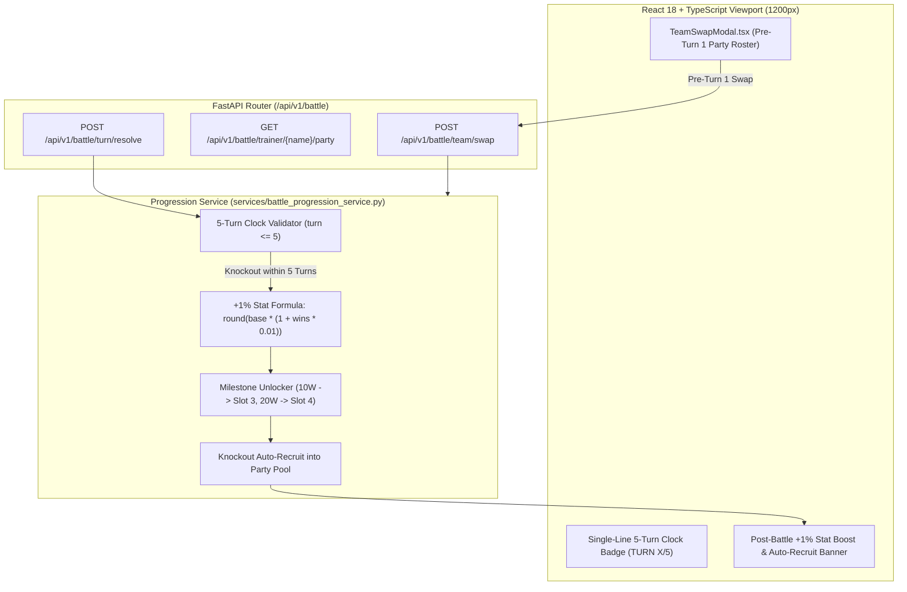

# Tutorial 6: 5-Turn Battle Clock, `TEAM` Swap & +1% Stat Progression per Victory

> **Branch Checkpoints**:
> - Starter Code: `git checkout lesson-06-starter`
> - Reference Solution: `git checkout lesson-06-solution`

---

## 1. Lesson Overview & Architecture

In this lesson, we upgrade the **PokeAI Stadium** from a static exhibition match into a full **Tournament Progression Engine** with non-stationary entity state:
1. **The Strict 5-Turn Battle Clock**: Every match lasts at most **5 turns** (`turn_counter <= 5`). If neither monster is knocked out by the end of Turn 5, the match concludes on the clock (preparing the stage for the **Catch Pokémon Roulette Phase** in Lesson 7).
2. **Pre-Turn 1 `TEAM` Party Swap**: Trainers can swap their active partner from their party pool before Turn 1 begins. If the trainer only owns 1 monster, the `TEAM` button is disabled (`TEAM (🔒 1/1)`).
3. **Auto-Recruit on Knockout**: Knocking out an opponent within 5 turns immediately recruits that monster into the trainer's party pool, unlocking `TEAM` swaps for future matches.
4. **+1% Incremental Stat Mastery per Victory**: Every knockout victory permanently increases the winning monster's HP, Attack, Defense, and Speed by **+1%**:
   $$\text{effective\_stat} = \text{round}(\text{base\_stat} \times (1.0 + \text{victories\_count} \times 0.01))$$
5. **Move Slot Unlock Milestones**: Reaching **10 victories** unlocks **Move Slot 3** (e.g., *Ember* [Fire]) alongside a +10% stat boost; reaching **20 victories** unlocks **Move Slot 4** (e.g., *Flamethrower* [Fire]) alongside a +20% stat boost.

### Architecture Diagram



---

## 2. Core AI Engineering Concept Explained

### Non-Stationary State & Dynamic Threat Calibration

In static software, entities never change their baseline parameters. In real-world AI systems and games, **state is non-stationary**—meaning a user's capabilities, resources, or threat level evolve over time.

| Progression Mechanism | AI Engineering Purpose |
| :--- | :--- |
| **`stat_progression_multiplier = 1.0 + (wins * 0.01)`** | Dynamically scales combat stats so downstream AI agents (Lessons 8–9) must inspect real-time effective stats rather than relying on memorized training-set base stats. |
| **10W / 20W Move Slot Unlocks** | Expands the action space available to both the player and tactical RAG advisors as the monster matures. |
| **Pre-Turn 1 State Machine Gate** | Enforces strict temporal preconditions (`current_turn_number == 1` and `total_party_count > 1`) before allowing state transitions. |

> 🏟️ **The Stadium Metaphor**: A rookie Charmander entering its first match only knows *Scratch* and *Growl*. After 10 tournament victories, its stats are 10% stronger and it has mastered *Ember*. An intelligent Gym Leader AI (Lesson 9) can't treat a 20-win veteran Charmander the same way it treats a 0-win rookie!

---

## 3. Step-by-Step Build Walkthrough

### Step 3.1: Defining Progression Data Contracts

Create [`backend/src/schemas/progression_schema.py`](file:///c:/Users/roeld.JAYMIE-DESKTOP/Desktop/CODE/projects/PokeAI/backend/src/schemas/progression_schema.py) to validate party monsters, swap requests, and post-victory rewards:

```python
class RecruitedPartyMonster(BaseModel):
    pokemon_id: int = Field(description="National Pokédex ID of the monster")
    pokemon_name: str = Field(description="Species name of the monster")
    victories_count: int = Field(default=0, ge=0, description="Cumulative victories earned")
    stat_progression_multiplier: float = Field(default=1.0, ge=1.0, description="+1% per win multiplier")
    effective_health_points: int = Field(ge=1, description="Scaled maximum health points")
    effective_attack_stat: int = Field(ge=1, description="Scaled attack stat")
    effective_defense_stat: int = Field(ge=1, description="Scaled defense stat")
    effective_speed_stat: int = Field(ge=1, description="Scaled speed stat")
    move_slots: List[PokemonMoveSlot] = Field(description="Move palette with milestone unlock flags")
```

### Step 3.2: Implementing the Progression & Party Swap Service

Create [`backend/src/services/battle_progression_service.py`](file:///c:/Users/roeld.JAYMIE-DESKTOP/Desktop/CODE/projects/PokeAI/backend/src/services/battle_progression_service.py):

```python
@staticmethod
def calculate_effective_scaled_stat(base_stat_value: int, victories_count: int) -> int:
    progression_multiplier = round(1.0 + (max(0, victories_count) * 0.01), 4)
    scaled_stat_integer = round(base_stat_value * progression_multiplier)
    return max(1, int(scaled_stat_integer))
```

### Step 3.3: Exposing `TEAM` Swap & Party Pool Endpoints

Add `POST /api/v1/battle/team/swap` and `GET /api/v1/battle/trainer/{trainer_name}/party` in [`backend/src/routes/battle_routes.py`](file:///c:/Users/roeld.JAYMIE-DESKTOP/Desktop/CODE/projects/PokeAI/backend/src/routes/battle_routes.py).

### Step 3.4: Building the `TeamSwapModal` & 5-Turn Clock HUD

Create [`frontend/src/components/ui/TeamSwapModal.tsx`](file:///c:/Users/roeld.JAYMIE-DESKTOP/Desktop/CODE/projects/PokeAI/frontend/src/components/ui/TeamSwapModal.tsx) and integrate it into [`frontend/src/components/screen/BattleArenaScreen.tsx`](file:///c:/Users/roeld.JAYMIE-DESKTOP/Desktop/CODE/projects/PokeAI/frontend/src/components/screen/BattleArenaScreen.tsx).

---

## 4. Testing & Verification Gate

Run the Lesson 6 unit test suite inside the backend virtual environment:

```powershell
backend\.venv\Scripts\pytest backend\tests\test_battle_progression.py -v
```

### Expected Output

```text
backend/tests/test_battle_progression.py::test_five_turn_battle_clock_enforces_expiration PASSED [ 16%]
backend/tests/test_battle_progression.py::test_team_swap_disabled_when_party_has_one_monster PASSED [ 33%]
backend/tests/test_battle_progression.py::test_pre_turn_one_team_swap_succeeds_and_post_turn_one_swap_rejected PASSED [ 50%]
backend/tests/test_battle_progression.py::test_incremental_one_percent_stat_progression_formula PASSED [ 66%]
backend/tests/test_battle_progression.py::test_move_slot_unlock_milestones_at_ten_and_twenty_victories PASSED [ 83%]
backend/tests/test_battle_progression.py::test_knockout_auto_recruits_opponent_and_increments_victory_stats PASSED [100%]

============================== 6 passed in 0.09s ==============================
```
