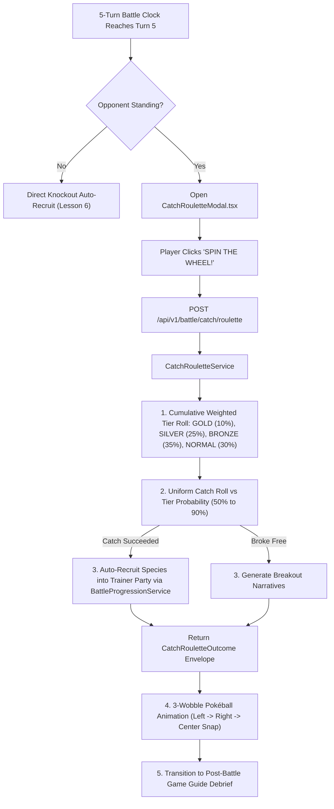

# Lesson 7: The Pokéball Roulette Wheel — Turn-5 Catch Roulette Phase

> **Branch Checkpoints**:
> - Starter Code: `git checkout lesson-07-starter`
> - Reference Solution: `git checkout lesson-07-solution`

---

## 1. Lesson Overview & Architecture

In **Lesson 6**, we established the 5-Turn Battle Clock, pre-turn `TEAM` party swaps, and the +1% post-victory stat progression scaling. When Turn 5 concludes without either combatant fainting, the battle clock expires!

**Lesson 7 introduces the High-Stakes Pokéball Roulette Wheel**:
Instead of letting the wild opponent simply flee into the grass, the tournament transitions into an overtime capture phase. The player spins an animated, weighted arcade roulette wheel across 4 Pokéball tiers (**Gold 90%**, **Silver 75%**, **Bronze 60%**, **Normal 50%**) and throws for an overtime capture, complete with authentic 3-wobble suspense and automatic party roster recruitment.

### Architecture Diagram



---

## 2. Core AI & Game Engineering Concept Explained

### 2.1 What is it? (Weighted Probability Distributions & State Machine Transitions)
In game design and generative AI systems, not all random events are equally likely. A **discrete weighted probability distribution** assigns relative likelihoods (weights) to discrete outcomes:
$$\sum_{i=1}^{n} w_i = 1.0$$

In our stadium roulette wheel:
- **Gold Pokéball**: 10% wheel landing weight $\rightarrow$ **90% catch rate** (0.90)
- **Silver Pokéball**: 25% wheel landing weight $\rightarrow$ **75% catch rate** (0.75)
- **Bronze Pokéball**: 35% wheel landing weight $\rightarrow$ **60% catch rate** (0.60)
- **Normal Pokéball**: 30% wheel landing weight $\rightarrow$ **50% catch rate** (0.50)

### 2.2 Why do we need it in AI Engineering?
In AI engineering, weighted probability sampling is identical to how Large Language Models generate text using **temperature** and **top-p (nucleus) sampling**:
1. The model computes unnormalized log-probabilities (logits) for candidate tokens.
2. A probability distribution is constructed using a softmax activation.
3. The sampler rolls a uniform random float across cumulative intervals to pick the token.

By implementing discrete cumulative sampling on the backend with deterministic test injections, learners master the foundational mathematics behind probabilistic AI sampling.

---

## 3. Step-by-Step Build Walkthrough

### Step 3.1: Defining the Catch Schema Contract

Create [`backend/src/schemas/catch_schema.py`](file:///c:/Users/roeld.JAYMIE-DESKTOP/Desktop/CODE/projects/PokeAI/backend/src/schemas/catch_schema.py):

```python
from enum import Enum
from typing import Optional
from pydantic import BaseModel, Field
from src.schemas.progression_schema import TrainerPartyPoolState


class PokeballTier(str, Enum):
    """The four canonical Pokéball tiers available on the retro roulette wheel."""
    GOLD = "GOLD"        # 90% capture rate
    SILVER = "SILVER"    # 75% capture rate
    BRONZE = "BRONZE"    # 60% capture rate
    NORMAL = "NORMAL"    # 50% capture rate


class CatchRouletteSpinRequest(BaseModel):
    """Request envelope sent from frontend when the player spins the wheel."""
    trainer_name: str = Field(..., min_length=1, description="Registered trainer profile identifier.")
    opponent_pokemon_id: int = Field(..., gt=0, description="PokéAPI species ID of targeted monster.")
    opponent_pokemon_name: str = Field(..., min_length=1, description="Display name of target monster.")
    opponent_pokemon_sprite_url: str = Field(default="", description="Front sprite image URL.")
    opponent_level: int = Field(default=5, ge=1, description="Level of the targeted wild monster.")
    injected_tier_roll: Optional[float] = Field(default=None, ge=0.0, le=1.0)
    injected_catch_roll: Optional[float] = Field(default=None, ge=0.0, le=1.0)


class CatchRouletteOutcome(BaseModel):
    """Comprehensive outcome returned after the wheel spins and catch resolves."""
    selected_pokeball_tier: PokeballTier = Field(..., description="Tier landed on the wheel.")
    capture_probability: float = Field(..., description="Calibrated capture probability (0.50 to 0.90).")
    capture_successful: bool = Field(..., description="Whether the capture roll succeeded.")
    captured_monster_name: str = Field(..., description="Display name of target monster.")
    narrative_outcome: str = Field(..., description="Commentator announcement.")
    updated_party_pool: Optional[TrainerPartyPoolState] = Field(default=None)
```

---

### Step 3.2: Implementing `CatchRouletteService`

Create [`backend/src/services/catch_roulette_service.py`](file:///c:/Users/roeld.JAYMIE-DESKTOP/Desktop/CODE/projects/PokeAI/backend/src/services/catch_roulette_service.py):

```python
import random
from typing import Dict, Optional
from src.schemas.catch_schema import CatchRouletteOutcome, CatchRouletteSpinRequest, PokeballTier
from src.schemas.progression_schema import TrainerPartyPoolState
from src.services.battle_progression_service import battle_progression_service

TIER_SPECIFICATIONS: Dict[PokeballTier, Dict[str, float]] = {
    PokeballTier.GOLD: {"capture_probability": 0.90, "wheel_weight": 0.10},
    PokeballTier.SILVER: {"capture_probability": 0.75, "wheel_weight": 0.25},
    PokeballTier.BRONZE: {"capture_probability": 0.60, "wheel_weight": 0.35},
    PokeballTier.NORMAL: {"capture_probability": 0.50, "wheel_weight": 0.30},
}


class CatchRouletteService:
    @staticmethod
    def select_pokeball_tier(injected_tier_roll: Optional[float] = None) -> PokeballTier:
        wheel_roll = injected_tier_roll if injected_tier_roll is not None else random.random()
        gold_boundary = 0.10
        silver_boundary = 0.35
        bronze_boundary = 0.70

        if wheel_roll < gold_boundary:
            return PokeballTier.GOLD
        elif wheel_roll < silver_boundary:
            return PokeballTier.SILVER
        elif wheel_roll < bronze_boundary:
            return PokeballTier.BRONZE
        else:
            return PokeballTier.NORMAL

    @staticmethod
    def evaluate_catch_attempt(
        pokeball_tier: PokeballTier,
        injected_catch_roll: Optional[float] = None,
    ) -> bool:
        threshold = TIER_SPECIFICATIONS[pokeball_tier]["capture_probability"]
        catch_roll = injected_catch_roll if injected_catch_roll is not None else random.random()
        return catch_roll < threshold
```

---

### Step 3.3: Exposing the Endpoint in `battle_routes.py`

Add `POST /api/v1/battle/catch/roulette` in [`backend/src/routes/battle_routes.py`](file:///c:/Users/roeld.JAYMIE-DESKTOP/Desktop/CODE/projects/PokeAI/backend/src/routes/battle_routes.py).

---

### Step 3.4: Building the `CatchRouletteModal` UI Component

Create [`frontend/src/components/ui/CatchRouletteModal.tsx`](file:///c:/Users/roeld.JAYMIE-DESKTOP/Desktop/CODE/projects/PokeAI/frontend/src/components/ui/CatchRouletteModal.tsx) and integrate it into [`frontend/src/components/screen/BattleArenaScreen.tsx`](file:///c:/Users/roeld.JAYMIE-DESKTOP/Desktop/CODE/projects/PokeAI/frontend/src/components/screen/BattleArenaScreen.tsx).

---

## 4. Testing & Verification Gate

Run the Lesson 7 unit test suite inside the backend virtual environment:

```powershell
backend\.venv\Scripts\pytest backend\tests\test_catch_roulette.py -v
```

### Expected Output

```text
backend/tests/test_catch_roulette.py::test_pokeball_tier_calibrated_probabilities PASSED [ 14%]
backend/tests/test_catch_roulette.py::test_deterministic_tier_selection_boundaries PASSED [ 28%]
backend/tests/test_catch_roulette.py::test_deterministic_catch_evaluation_success_and_failure PASSED [ 42%]
backend/tests/test_catch_roulette.py::test_catch_roulette_successful_recruitment_updates_party_pool PASSED [ 57%]
backend/tests/test_catch_roulette.py::test_catch_roulette_failure_narrative_and_no_recruitment PASSED [ 71%]
backend/tests/test_catch_roulette.py::test_statistical_distribution_simulation PASSED [ 85%]
backend/tests/test_catch_roulette.py::test_fastapi_roulette_endpoint PASSED [100%]

============================== 7 passed in 2.72s ==============================
```
