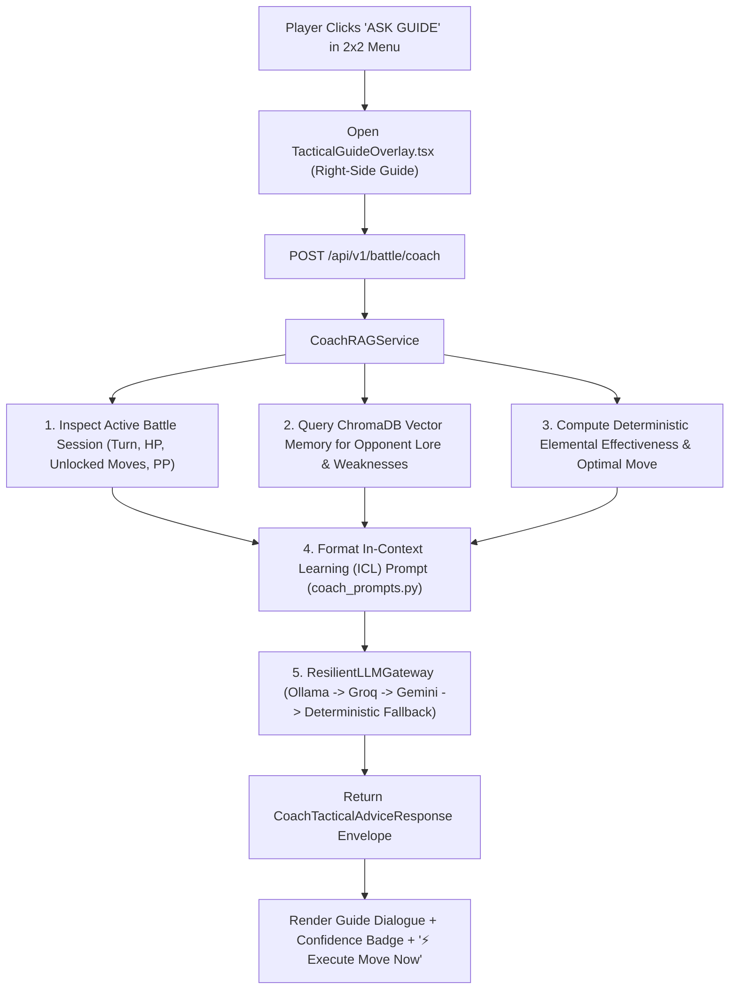

# Lesson 8: The `ASK GUIDE` Tactical Battle Whisperer — Dynamic In-Context RAG

> **Branch Checkpoints**:
> - Starter Code: `git checkout lesson-08-starter`
> - Reference Solution: `git checkout lesson-08-solution`

---

## 1. Lesson Overview & Architecture

In **Lessons 5–7**, we engineered the deterministic GBA Battle Engine, the 5-Turn Battle Clock, pre-turn `TEAM` party swaps, +1% post-victory stat progression, and the overtime Pokéball Roulette Phase. Now, it is time to connect our **ChromaDB Pokédex Vector Memory (Lesson 4)** and **Resilient LLM Gateway (Lesson 2)** directly into live combat!

**Lesson 8 introduces the `ASK GUIDE` Tactical Battle Whisperer**:
When the player clicks `ASK GUIDE` on the 2x2 action menu, the battle pauses and the **Game Guide** slides into the right side of the viewport. Behind the scenes, `CoachRAGService` queries ChromaDB for the active opponent's species lore and weaknesses, evaluates elemental effectiveness across the player's unlocked moves with remaining Power Points (PP), and whispers a high-confidence counter-move recommendation with a one-click execution button.

### Architecture Diagram



---

## 2. Core AI Engineering Concept Explained

### 2.1 What is Dynamic In-Context RAG?
Standard chatbots rely exclusively on weights frozen during model pre-training. When asked about a fast-moving game state (*"Which of my unlocked moves has PP left and hits Pidgey hardest?"*), an ungrounded LLM will frequently hallucinate moves the monster hasn't unlocked yet (like *Flamethrower* at Level 6) or misremember elemental multipliers.

**Dynamic In-Context Retrieval-Augmented Generation (RAG)** solves this by merging two distinct sources of truth into the prompt window right before inference:
1. **Unstructured Semantic Memory (ChromaDB)**: Retrieves the opponent species' biological lore, combat archetype, and elemental vulnerabilities via cosine similarity.
2. **Structured Real-Time Telemetry (Deterministic Engine)**: Injects the exact unlocked move slots, remaining PP, current HP ratios, and calculated effectiveness multipliers (`2x`, `1x`, `0.5x`).

### 2.2 Production Trade-offs (Latency vs Grounding Accuracy)
- **Strict Anti-Hallucination Guardrail**: Instead of letting the LLM guess the math, `CoachRAGService.evaluate_optimal_unlocked_move()` computes the mathematically optimal move deterministically first, then instructs the LLM to *explain* that recommendation in character.
- **Zero-Downtime Deterministic Synthesis**: If all cloud and local LLM channels are offline, the service synthesizes a rich, context-aware tactical whisper in `< 2ms` so the player's battle never stalls.

---

## 3. Step-by-Step Build Walkthrough

### Step 3.1: Defining the Tactical Coach Schema (`backend/src/schemas/coach_schema.py`)

Create [`backend/src/schemas/coach_schema.py`](file:///c:/Users/roeld.JAYMIE-DESKTOP/Desktop/CODE/projects/PokeAI/backend/src/schemas/coach_schema.py):

```python
from typing import Optional
from pydantic import BaseModel, Field


class CoachTacticalAdviceRequest(BaseModel):
    """Request payload dispatched when a trainer selects 'ASK GUIDE' in the GBA Battle Arena."""
    battle_session_id: str = Field(..., min_length=1)
    custom_trainer_question: Optional[str] = Field(default=None)


class CoachTacticalAdviceResponse(BaseModel):
    """Comprehensive tactical advice envelope returned by the Game Guide RAG Coach."""
    battle_session_id: str
    game_guide_name: str
    recommended_action_name: str
    recommended_move_id: Optional[int] = Field(default=None)
    tactical_justification: str
    confidence_rating: float = Field(..., ge=0.0, le=1.0)
    retrieved_lore_context: str
    elemental_matchup_summary: str
    active_provider_name: str
    model_identifier: str
    execution_latency_milliseconds: float
```

---

### Step 3.2: Engineering the RAG Prompt Template (`backend/src/prompts/coach_prompts.py`)

Create [`backend/src/prompts/coach_prompts.py`](file:///c:/Users/roeld.JAYMIE-DESKTOP/Desktop/CODE/projects/PokeAI/backend/src/prompts/coach_prompts.py) to inject both live battle telemetry and ChromaDB vector lore into the Game Guide's persona.

---

### Step 3.3: Implementing `CoachRAGService` (`backend/src/services/coach_rag_service.py`)

Create [`backend/src/services/coach_rag_service.py`](file:///c:/Users/roeld.JAYMIE-DESKTOP/Desktop/CODE/projects/PokeAI/backend/src/services/coach_rag_service.py) and mount `POST /api/v1/battle/coach` and `GET /api/v1/battle/coach/{battle_session_id}` inside [`backend/src/routes/battle_routes.py`](file:///c:/Users/roeld.JAYMIE-DESKTOP/Desktop/CODE/projects/PokeAI/backend/src/routes/battle_routes.py).

---

### Step 3.4: Building `TacticalGuideOverlay.tsx` (`frontend/src/components/ui/TacticalGuideOverlay.tsx`)

Create [`frontend/src/components/ui/TacticalGuideOverlay.tsx`](file:///c:/Users/roeld.JAYMIE-DESKTOP/Desktop/CODE/projects/PokeAI/frontend/src/components/ui/TacticalGuideOverlay.tsx) and connect it to the `ASK GUIDE` button inside [`frontend/src/components/screen/BattleArenaScreen.tsx`](file:///c:/Users/roeld.JAYMIE-DESKTOP/Desktop/CODE/projects/PokeAI/frontend/src/components/screen/BattleArenaScreen.tsx).

---

## 4. Testing & Verification Gate

Run the Lesson 8 test suite to verify super-effective move selection, locked-slot filtering, PP exhaustion handling, ChromaDB lore retrieval, and FastAPI endpoint contracts:

```powershell
$env:PYTHONPATH="backend"
.\backend\.venv\Scripts\pytest backend/tests/test_coach_rag.py -v
```

### Expected Output

```text
backend/tests/test_coach_rag.py::test_coach_recommends_super_effective_move_against_known_weakness PASSED [ 16%]
backend/tests/test_coach_rag.py::test_coach_respects_locked_move_slots_and_prefers_damaging_move PASSED [ 33%]
backend/tests/test_coach_rag.py::test_coach_skips_zero_pp_exhausted_moves PASSED [ 50%]
backend/tests/test_coach_rag.py::test_coach_retrieves_chromadb_vector_lore_or_graceful_archive_fallback PASSED [ 66%]
backend/tests/test_coach_rag.py::test_coach_tactical_advice_service_pipeline PASSED [ 83%]
backend/tests/test_coach_rag.py::test_fastapi_coach_endpoints_post_and_get PASSED [100%]

============================== 6 passed in 2.45s ==============================
```

---

## 5. Common Pitfalls & Debugging Guide

| Issue / Error Message | Root Cause | How to Fix |
| :--- | :--- | :--- |
| Coach recommends a move locked behind 10 or 20 wins | Move filter did not check `move_slot.is_unlocked` before scoring. | Filter `player_monster.move_slots` with `if move_slot.is_unlocked and move_slot.current_power_points > 0`. |
| `404 Not Found` when clicking `ASK GUIDE` | Frontend sent an expired or empty `battle_session_id`. | Ensure `activeSession.battle_session_id` is initialized via `POST /api/v1/battle/initiate` before enabling `ASK GUIDE`. |
| Empty vector results on fresh environment | ChromaDB collection has not been seeded yet. | `CoachRAGService` automatically falls back to `CANONICAL_FALLBACK_SPECIES_LORE`, or you can click `Sync PokeAPI` in the Smart Pokédex screen. |

---

## 6. Self-Study Challenge

- **Challenge**: Enhance `CoachRAGService.evaluate_optimal_unlocked_move()` to factor in **Defensive Survival Urgency**: if the player's monster is below 25% HP and slower than the opponent, lower the confidence rating and warn the trainer in `tactical_justification` that the opponent will strike first!
- **Hint**: Compare `player_monster.speed_stat < opponent_monster.speed_stat` and check `(player_monster.current_health_points / player_monster.maximum_health_points) <= 0.25`.
