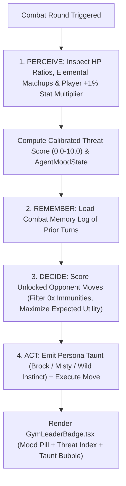

# Lesson 9: Autonomous Gym Leader AI Agent — Dynamic Threat Calibration & Personas

> **Branch Checkpoints**:
> - Starter Code: `git checkout lesson-09-starter`
> - Reference Solution: `git checkout lesson-09-solution`

---

## 1. Lesson Overview & Architecture

In **Lesson 8**, we equipped the player with the `ASK GUIDE` Tactical RAG Coach. Now, it is time to upgrade our opponent from a static rule follower into an **Autonomous AI Agent** capable of perceiving non-stationary player progression, remembering prior turns, and adapting its tactical posture!

**Lesson 9 introduces the Autonomous Gym Leader AI Agent (`GymLeaderAgentService`)**:
Every turn, the opponent executes a 4-stage **Perceive $\rightarrow$ Remember $\rightarrow$ Decide $\rightarrow$ Act** decision loop. It detects the player's accumulated **+1% victory stat progression multiplier (`stat_progression_multiplier`)**, shifts its `AgentMoodState` (`CALCULATING`, `AGGRESSIVE`, `DEFENSIVE`, or `DESPERATE_CLUTCH`), chooses the mathematically optimal move (achieving $>90\%$ optimal selection under low HP and avoiding $0\times$ immunities), and emits persona-conditioned battle taunts as **Gym Leader Brock (Onix Lv 8)**, **Gym Leader Misty (Starmie Lv 9)**, or **Wild Instinct (Pidgey Lv 5)**.

### Architecture Diagram



---

## 2. Core AI Engineering Concept Explained

### 2.1 Autonomous Single-Agent Loops (`Perceive -> Remember -> Decide -> Act`)
Unlike a single stateless prompt, an **autonomous agent** operates in a continuous feedback loop with its environment:
1. **Perceive**: Reads structured sensors from the environment (current HP, opponent elemental types, and the player's non-stationary `stat_progression_multiplier`).
2. **Remember**: Consults episodic working memory (`combat_memory_log`) recording moves exchanged in previous turns.
3. **Decide**: Evaluates candidate actions against a utility function conditioned on its current state (`AgentMoodState`).
4. **Act**: Executes the selected move in the deterministic engine and communicates its persona-conditioned battle taunt.

### 2.2 Non-Stationary Threat Calibration
Because the player's monster gains **+1% stats per victory** (`stat_progression_multiplier = 1.0 + victories * 0.01`), a move that was safe against a `1.00x` starter can become fatal against a `1.15x` veteran. Our agent dynamically scales its `calibrated_threat_score` with the player's multiplier and switches into `AGGRESSIVE` or `DESPERATE_CLUTCH` mode when HP drops to $\le 30\%$.

---

## 3. Step-by-Step Build Walkthrough

### Step 3.1: Defining the Agent Schemas (`backend/src/schemas/gym_leader_schema.py`)

Create [`backend/src/schemas/gym_leader_schema.py`](file:///c:/Users/roeld.JAYMIE-DESKTOP/Desktop/CODE/projects/PokeAI/backend/src/schemas/gym_leader_schema.py):

```python
from enum import Enum
from pydantic import BaseModel, Field


class GymLeaderPersona(str, Enum):
    WILD_INSTINCT = "WILD_INSTINCT"
    BROCK = "BROCK"
    MISTY = "MISTY"


class AgentMoodState(str, Enum):
    CALCULATING = "CALCULATING"
    AGGRESSIVE = "AGGRESSIVE"
    DEFENSIVE = "DEFENSIVE"
    DESPERATE_CLUTCH = "DESPERATE_CLUTCH"


class GymLeaderTurnDecision(BaseModel):
    selected_move_id: int
    selected_move_name: str
    internal_tactical_reasoning: str
    in_character_dialogue_taunt: str
    agent_mood: AgentMoodState
    calibrated_threat_score: float = Field(ge=0.0, le=10.0)
    detected_player_stat_multiplier: float = Field(default=1.0, ge=1.0)
    gym_leader_persona: GymLeaderPersona = Field(default=GymLeaderPersona.WILD_INSTINCT)
    active_provider_name: str = Field(default="autonomous_agent_engine")
    execution_latency_milliseconds: float = Field(default=0.0, ge=0.0)
```

---

### Step 3.2: Implementing `GymLeaderAgentService` (`backend/src/services/gym_leader_agent.py`)

Create [`backend/src/services/gym_leader_agent.py`](file:///c:/Users/roeld.JAYMIE-DESKTOP/Desktop/CODE/projects/PokeAI/backend/src/services/gym_leader_agent.py) and [`backend/src/prompts/gym_leader_prompts.py`](file:///c:/Users/roeld.JAYMIE-DESKTOP/Desktop/CODE/projects/PokeAI/backend/src/prompts/gym_leader_prompts.py), and integrate the synchronous decision loop into [`backend/src/services/battle_engine.py`](file:///c:/Users/roeld.JAYMIE-DESKTOP/Desktop/CODE/projects/PokeAI/backend/src/services/battle_engine.py) alongside `POST /api/v1/battle/gym-leader/decide` in [`backend/src/routes/battle_routes.py`](file:///c:/Users/roeld.JAYMIE-DESKTOP/Desktop/CODE/projects/PokeAI/backend/src/routes/battle_routes.py).

---

### Step 3.3: Building `GymLeaderBadge.tsx` (`frontend/src/components/ui/GymLeaderBadge.tsx`)

Create [`frontend/src/components/ui/GymLeaderBadge.tsx`](file:///c:/Users/roeld.JAYMIE-DESKTOP/Desktop/CODE/projects/PokeAI/frontend/src/components/ui/GymLeaderBadge.tsx) and render it inside the Opponent HUD card in [`frontend/src/components/screen/BattleArenaScreen.tsx`](file:///c:/Users/roeld.JAYMIE-DESKTOP/Desktop/CODE/projects/PokeAI/frontend/src/components/screen/BattleArenaScreen.tsx).

---

## 4. Testing & Verification Gate

Run the Lesson 9 test suite to validate persona resolution, dynamic threat calibration, low-HP `DESPERATE_CLUTCH` optimal move selection ($>90\%$), immunity avoidance, and FastAPI endpoints:

```powershell
$env:PYTHONPATH="backend"
.\backend\.venv\Scripts\pytest backend/tests/test_gym_leader_agent.py -v
```

### Expected Output

```text
backend/tests/test_gym_leader_agent.py::test_persona_resolution_for_brock_misty_and_wild_instinct PASSED [ 16%]
backend/tests/test_gym_leader_agent.py::test_dynamic_threat_calibration_scales_with_player_victory_stat_multiplier PASSED [ 33%]
backend/tests/test_gym_leader_agent.py::test_desperate_clutch_mood_and_optimal_move_selection_under_low_hp PASSED [ 50%]
backend/tests/test_gym_leader_agent.py::test_agent_avoids_zero_multiplier_immune_moves PASSED [ 66%]
backend/tests/test_gym_leader_agent.py::test_battle_engine_integrates_autonomous_gym_leader_decision_and_combat_memory PASSED [ 83%]
backend/tests/test_gym_leader_agent.py::test_fastapi_gym_leader_decide_endpoint PASSED [100%]

============================== 6 passed in 2.38s ==============================
```

---

## 5. Common Pitfalls & Debugging Guide

| Issue / Error Message | Root Cause | How to Fix |
| :--- | :--- | :--- |
| Agent selects a `0x` move against Ground or Ghost types | Utility function multiplied `0 * base_power = 0`, which tied with status moves when no negative penalty was applied. | Explicitly assign a strong negative utility score (`-100.0`) whenever `effectiveness_multiplier == 0.0 and base_power > 0`. |
| `detected_player_stat_multiplier` stays at `1.0` after victories | Session lookup did not match `player_monster.pokemon_id` inside `party_pool["party_monsters"]`. | Iterate over `party_pool.get("party_monsters", [])` and match on `pokemon_id`. |

---

## 6. Self-Study Challenge

- **Challenge**: Add a 4th Gym Leader persona: **Lt. Surge (`LT_SURGE`)** commanding **Raichu (`#26`, Lv 10, Electric)** with *Thunderbolt*, *Quick Attack*, and *Iron Tail*, and add a challenger pill in `GymLeaderBadge.tsx`!
- **Hint**: Add `LT_SURGE = "LT_SURGE"` to `GymLeaderPersona` and map `pokemon_id == 26` in `resolve_persona_for_opponent`.
