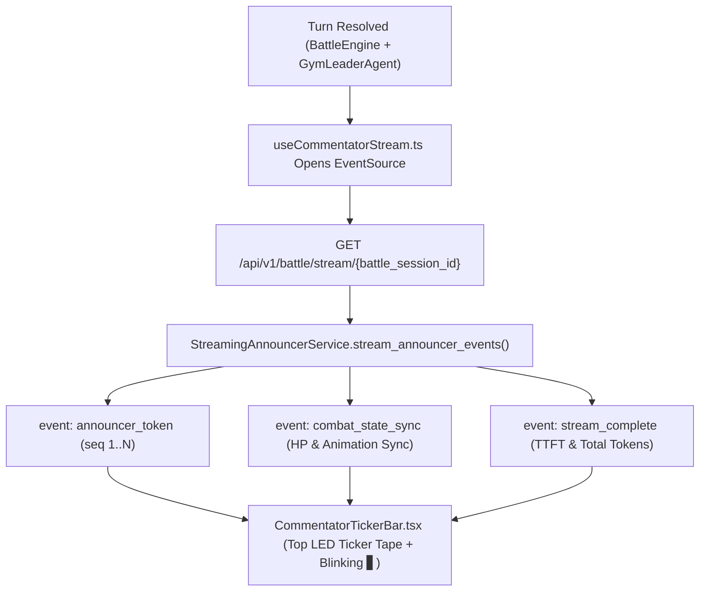

# Lesson 10: Live Stadium Announcer via FastAPI SSE Token Streaming

> **Branch Checkpoints**:
> - Starter Code: `git checkout lesson-10-starter`
> - Reference Solution: `git checkout lesson-10-solution`

---

## 1. Lesson Overview & Architecture

In **Lesson 9**, we built the Autonomous Gym Leader AI Agent with dynamic threat calibration and persona taunts. Now, we coordinate our multi-agent stadium so the **Live Stadium Announcer** streams syllable-by-syllable play-by-play commentary across a dedicated LED Ticker Tape at the top of the GBA Battle Arena!

**Lesson 10 introduces Server-Sent Events (SSE) Token Streaming (`StreamingAnnouncerService`)**:
Instead of blocking the UI while waiting for a full paragraph of commentary, FastAPI opens a unidirectional `text/event-stream` channel (`GET /api/v1/battle/stream/{battle_session_id}`). As soon as a battle starts or a turn resolves, the announcer streams `announcer_token` events with sequential `sequence_id`s, followed by a `combat_state_sync` event and a `stream_complete` summary—achieving sub-400ms Time-To-First-Token (TTFT).

### Architecture Diagram



---

## 2. Core AI Engineering Concept Explained

### 2.1 Why Server-Sent Events (SSE) Instead of WebSockets or REST Polling?
In production AI applications, token generation is inherently **asymmetric**: the client sends a small request and the server streams back dozens of incremental tokens over HTTP.
- **REST Polling**: High latency; the user stares at a spinner until the final token is generated.
- **WebSockets**: Full-duplex binary/text sockets that require custom reconnection logic, heartbeats, and stateful load-balancer sticky sessions.
- **Server-Sent Events (SSE)**: Standard HTTP (`Content-Type: text/event-stream`) with native browser `EventSource` support, automatic reconnection, and zero-overhead unidirectional token streaming.

### 2.2 Multi-Agent Coordination & Time-To-First-Token (TTFT)
Our stadium coordinates three distinct engines in strict sequence:
1. **Autonomous Gym Leader Agent** decides its move and mood (`Perceive -> Remember -> Decide -> Act`).
2. **Deterministic Battle Engine** resolves speed priority, damage math, and HP state transitions.
3. **Streaming Announcer** reads the resolved state and streams play-by-play tokens immediately (`TTFT < 400ms`).

---

## 3. Step-by-Step Build Walkthrough

### Step 3.1: Implementing `StreamingAnnouncerService` (`backend/src/services/streaming_announcer_service.py`)

Create [`backend/src/services/streaming_announcer_service.py`](file:///c:/Users/roeld.JAYMIE-DESKTOP/Desktop/CODE/projects/PokeAI/backend/src/services/streaming_announcer_service.py) to compose multi-agent play-by-play scripts and yield W3C-formatted SSE frames (`event: announcer_token`, `event: combat_state_sync`, `event: stream_complete`).

---

### Step 3.2: Exposing the FastAPI SSE Endpoints (`backend/src/routes/streaming_routes.py`)

Create [`backend/src/routes/streaming_routes.py`](file:///c:/Users/roeld.JAYMIE-DESKTOP/Desktop/CODE/projects/PokeAI/backend/src/routes/streaming_routes.py) and mount `streaming_router` in [`backend/src/main.py`](file:///c:/Users/roeld.JAYMIE-DESKTOP/Desktop/CODE/projects/PokeAI/backend/src/main.py):

```python
SSE_RESPONSE_HEADERS = {
    "Cache-Control": "no-cache",
    "Connection": "keep-alive",
    "X-Accel-Buffering": "no",
}
```

---

### Step 3.3: Building `useCommentatorStream.ts` and `CommentatorTickerBar.tsx`

Create [`frontend/src/hooks/useCommentatorStream.ts`](file:///c:/Users/roeld.JAYMIE-DESKTOP/Desktop/CODE/projects/PokeAI/frontend/src/hooks/useCommentatorStream.ts) and [`frontend/src/components/ui/CommentatorTickerBar.tsx`](file:///c:/Users/roeld.JAYMIE-DESKTOP/Desktop/CODE/projects/PokeAI/frontend/src/components/ui/CommentatorTickerBar.tsx), and mount the ticker bar at the top of [`frontend/src/components/screen/BattleArenaScreen.tsx`](file:///c:/Users/roeld.JAYMIE-DESKTOP/Desktop/CODE/projects/PokeAI/frontend/src/components/screen/BattleArenaScreen.tsx).

---

## 4. Testing & Verification Gate

Run the Lesson 10 test suite to verify script composition, SSE event ordering, sequence integrity, sub-400ms TTFT, and FastAPI `text/event-stream` endpoints:

```powershell
$env:PYTHONPATH="backend"
.\backend\.venv\Scripts\pytest backend/tests/test_streaming_announcer.py -v
```

### Expected Output

```text
backend/tests/test_streaming_announcer.py::test_announcer_script_composition_across_battle_phases PASSED [ 25%]
backend/tests/test_streaming_announcer.py::test_sse_token_stream_ordering_and_sequence_integrity PASSED [ 50%]
backend/tests/test_streaming_announcer.py::test_sub_400ms_time_to_first_token_sla PASSED [ 75%]
backend/tests/test_streaming_announcer.py::test_fastapi_sse_streaming_endpoints_path_and_query PASSED [100%]

============================== 4 passed in 2.31s ==============================
```

---

## 5. Common Pitfalls & Debugging Guide

| Issue / Error Message | Root Cause | How to Fix |
| :--- | :--- | :--- |
| Browser `EventSource` receives all tokens at once instead of streaming | Missing `X-Accel-Buffering: no` or `Cache-Control: no-cache` headers, or missing double newline `\n\n` after each SSE frame. | Terminate every SSE frame with `\n\n` and include `SSE_RESPONSE_HEADERS`. |
| Memory leak when rapidly clicking moves | Previous `EventSource` instance was not closed before opening a new stream. | Store the active `EventSource` in a `useRef` and call `.close()` before starting a new stream or on unmount. |

---

## 6. Self-Study Challenge

- **Challenge**: Add a `🔊 Mute / Unmute Ticker` toggle button to `CommentatorTickerBar.tsx` that pauses incoming token animations when muted while still recording `combat_state_sync` telemetry.
- **Hint**: Add a boolean `isTickerPaused` state inside `CommentatorTickerBar.tsx`.
