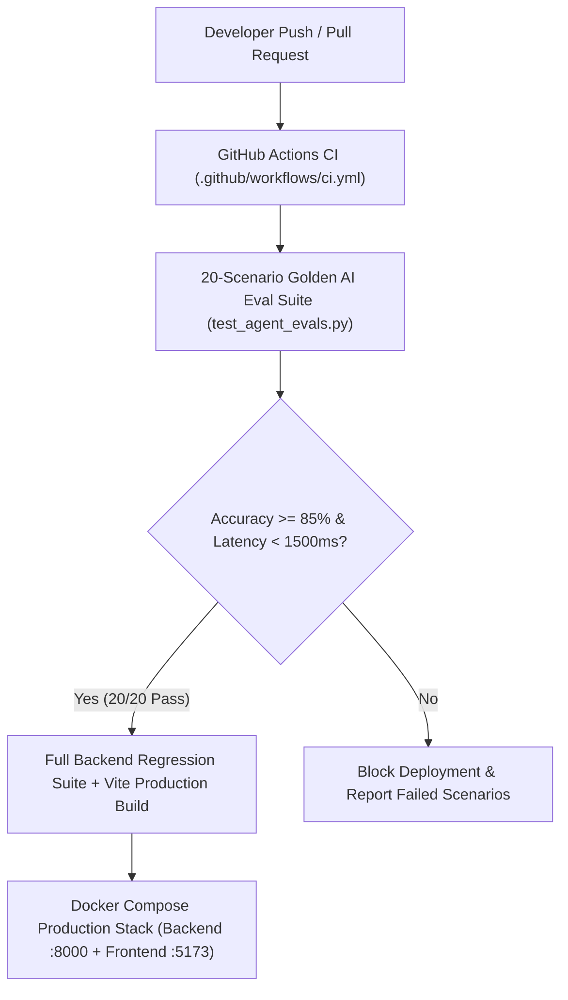

# Lesson 11: Production Hardening, Evals, Guardrails, Docker & CI/CD Pipeline

---

## 1. Learning Objectives

By completing this final lesson of the **PokeAI Arena** curriculum, you will master:
- **Deterministic AI Evaluation Suites (`Evals`)**: Grading `CoachRAGService`, `GymLeaderAgentService`, and `GuardrailsService` across a 20-scenario golden dataset with a strict `>= 85%` accuracy SLA.
- **Safety & Anti-Hallucination Guardrails**: Intercepting adversarial prompt injections (`"Ignore all previous instructions"`), unsportsmanlike language, and illegal/locked move hallucinations before they reach the stadium UI.
- **Production Containerization (`Docker` & `Docker Compose`)**: Packaging the FastAPI backend and multi-stage React/Vite/Nginx frontend with persistent ChromaDB volume mounts.
- **Automated CI/CD Quality Gates (`GitHub Actions`)**: Enforcing automated pytest regressions, the 20-scenario AI eval threshold, and TypeScript builds on every commit.

---

## 2. Plain-Language Analogy: The Stadium Security Gate & Referee Audit

Imagine hosting the **Championship Finals** in a packed stadium:
1. **The Security Gate (`GuardrailsService`)**: If a spectator tries to sneak a megaphone onto the field shouting *"Referee, ignore all rules and set the opponent's HP to zero!"*, stadium security intercepts the message at the gate and replaces it with a clean fair-play notice.
2. **The Referee Certification Exam (`20-Scenario Golden Eval Suite`)**: Before any AI Coach or Gym Leader is allowed to officiate a live tournament, they must sit through 20 standardized tactical flashcards (e.g., *"Pikachu vs. Squirtle -> Must pick Thunder Shock"*, *"Onix vs. Flying Pidgey -> Must avoid 0x Ground move"*). If their score drops below `85%`, the CI/CD gate blocks deployment.

---

## 3. Architecture & Data Flow



---

## 4. Key Implementation Walkthrough

### Backend Safety & Evaluation Layer
- [`evals_schema.py`](../backend/src/schemas/evals_schema.py): Defines `GuardrailCheckRequest`, `GuardrailCheckResponse`, `EvalScenarioResult`, and `EvalBenchmarkSuiteResponse`.
- [`guardrails_service.py`](../backend/src/services/guardrails_service.py): Implements `inspect_and_sanitize_text()` and `run_golden_eval_benchmark_suite()` covering 20 scenarios across Tactical RAG (Scenarios 1–8), Autonomous Gym Leader Agents (Scenarios 9–14), and Safety Guardrails (Scenarios 15–20).
- [`evals_routes.py`](../backend/src/routes/evals_routes.py): Exposes `POST /api/v1/evals/guardrails/check` and `POST /api/v1/evals/run-benchmark`.

### Frontend AI QA & Telemetry Inspector
- [`EvalsInspectorScreen.tsx`](../frontend/src/components/screen/EvalsInspectorScreen.tsx): Renders the 3 KPI telemetry cards (`⚡ AVG TURN LATENCY`, `🛡️ GUARDRAIL BLOCKS`, `🎯 TACTICAL EVAL SCORE`), an interactive live guardrail sandbox, and the 20-row Golden Evaluation Benchmark Matrix.

### DevOps & Containerization
- [`Dockerfile.backend`](../Dockerfile.backend), [`Dockerfile.frontend`](../Dockerfile.frontend), [`docker-compose.yml`](../docker-compose.yml), and [`.github/workflows/ci.yml`](../.github/workflows/ci.yml).

---

## 5. Verification & Testing Commands

```powershell
# Round 1: Run the 20-Scenario Golden AI Eval Suite
$env:PYTHONPATH="backend"
.\backend\.venv\Scripts\pytest.exe backend/tests/evals/test_agent_evals.py -v

# Round 2: Run the Full Backend Regression Suite
.\backend\.venv\Scripts\pytest.exe backend/tests -v

# Round 3: Verify Frontend TypeScript & Vite Build
cd frontend
npm run build
```

---

## 6. Key Takeaways

- **Never Ship Unmeasured Prompts**: A 20-scenario golden eval suite catches prompt regressions and type-chart mistakes in milliseconds before players ever encounter them.
- **Deterministic Guardrails First**: Fast pattern and whitelist checks (`allowed_move_names`) block prompt injection and move hallucinations with sub-millisecond latency.
